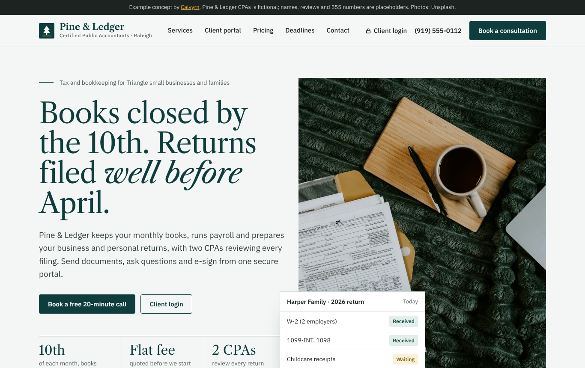
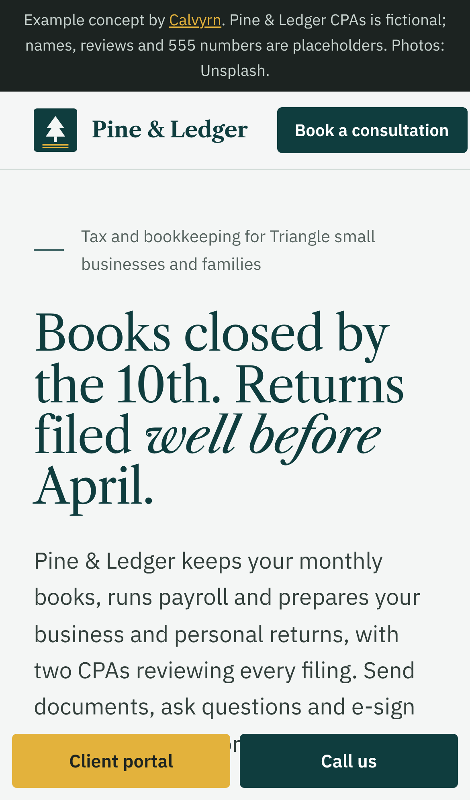

# Accounting firm with a client portal

**Tier:** Medium · **Industry:** Accounting & tax

A calm, grid-based CPA site with a working client-portal demo: a 2026 tax document checklist with uploads that stay in the browser, a status tracker from Received to In review to Ready to sign, a message thread with the CPA and an e-sign step. It also has table-style pricing and a live countdown to the next 2027 federal filing deadline.

**Live demo:** https://calvyrn.github.io/portfolio/sites/accounting-portal/

| Desktop | Phone |
|---|---|
|  |  |

**Why it matters:** Tax clients still email W-2s and drop off shoeboxes because their accountant gives them no better option. A portal with a clear checklist and a visible status cuts the "did you get my forms?" calls and makes a small firm look as organized as a big one.

**Design:** Libre Caslon Text + IBM Plex Sans with tabular numbers; pine, paper, ledger gold, sage. Structured 12-column grid, hairline rules, table-like pricing and deadlines. Single HTML file, no framework, keyboard accessible, responsive down to 360 px.

The business, people, reviews and phone numbers (555 numbers) are fictional placeholders. Deadline dates follow IRS due-date rules for tax year 2026. Photos are free-licence images from Unsplash.

---
Want this for your business? **info@calvyrn.com** · [calvyrn.com/contact.html](https://calvyrn.com/contact.html)
