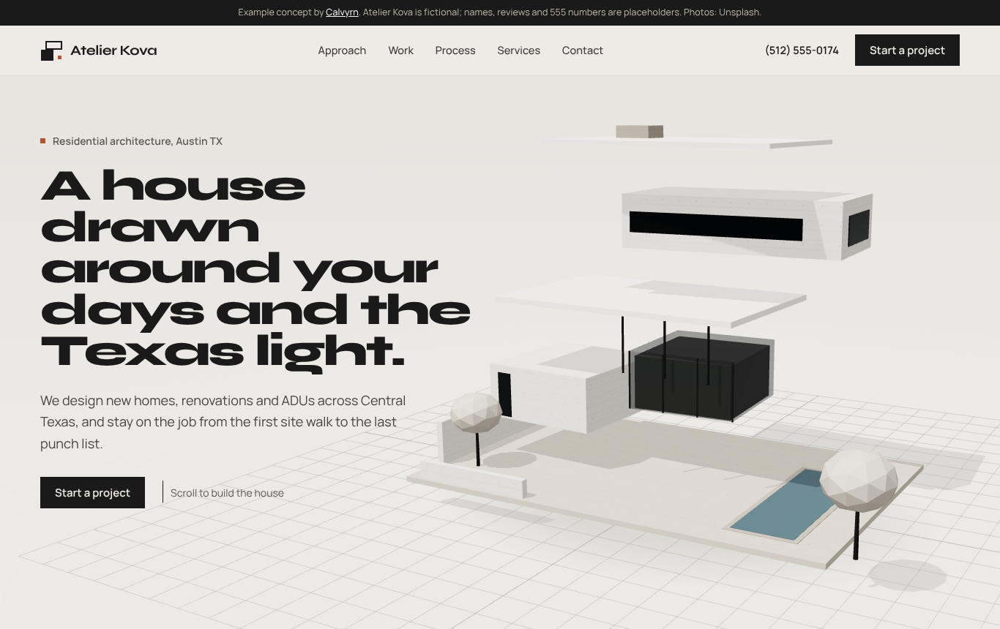
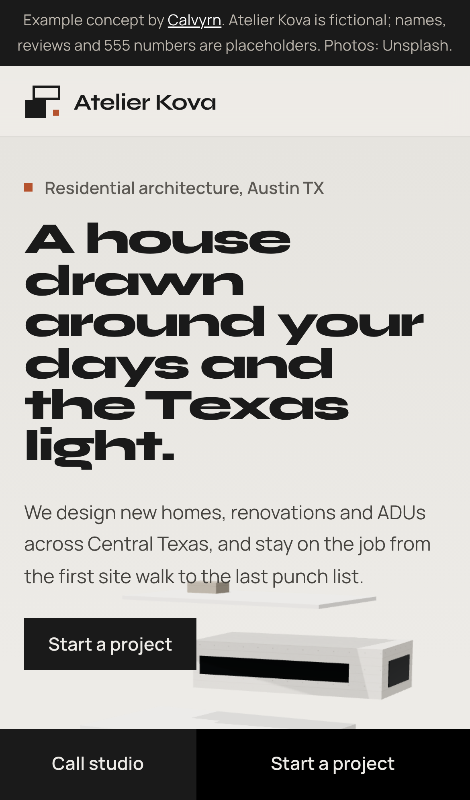

# Architecture studio with a 3D scroll story

**Tier:** High-end 3D · **Industry:** Architecture

Award-style scroll story for a residential architecture studio. A procedural Three.js concrete-and-glass house starts as a floating exploded model. As you scroll a pinned section, it assembles floor by floor, the camera orbits to the back, and the light moves from midday to golden hour, with the chapter titles "Site", "Form" and "Light" in sync. Below the story are selected projects, a four-step process, services, placeholder quotes, an FAQ and a validated "Start a project" form (project type, budget, timeline) with a map.

**Live demo:** https://calvyrn.github.io/portfolio/sites/architecture-studio-3d/

| Desktop | Phone |
|---|---|
|  |  |

**Why it matters:** An architect sells a way of thinking about space and light, and a scroll story that builds a house shows that better than a gallery of stock renders.

**Design:** Syne + Manrope; paper, ink, stone and sand, with a little architectural rust. Editorial asymmetric grid. Three.js (ACES tone mapping, soft shadows, procedural board-formed concrete), GSAP ScrollTrigger and Lenis. Single HTML file, no framework. Respects reduced motion and has a fallback if WebGL is missing.

The business, projects, reviews and phone number (555 number) are fictional placeholders. Photos are free-licence images from Unsplash.

---
Want this for your business? **info@calvyrn.com** · [calvyrn.com/contact.html](https://calvyrn.com/contact.html)
