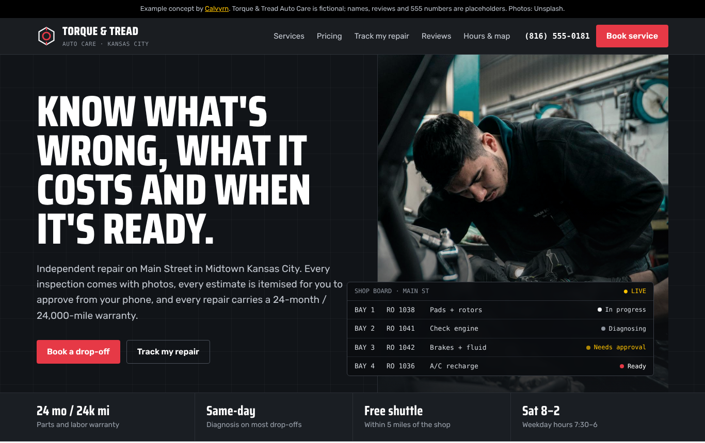
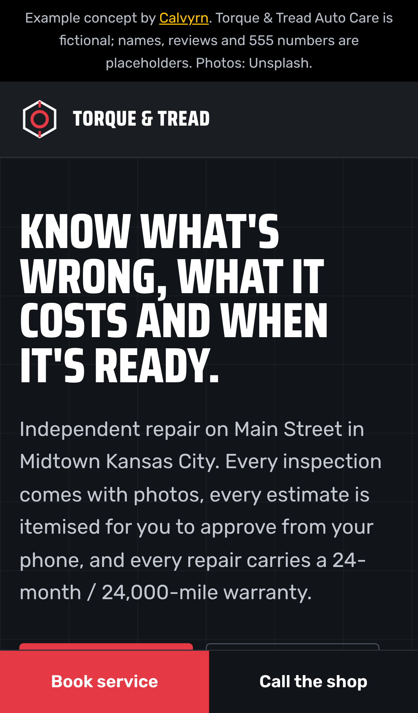

# Auto repair shop with booking and repair tracking

**Tier:** Medium · **Industry:** Auto repair

Garage-modern site for an independent shop: drivers book a drop-off (vehicle, services, day and time, loaner or wait) with a live work-order preview, then track their car by RO number through a status timeline, approve or decline each line of the estimate from their phone, and switch on text updates.

**Live demo:** https://calvyrn.github.io/portfolio/sites/auto-repair/

| Desktop | Phone |
|---|---|
|  |  |

**Why it matters:** "What's wrong, what will it cost and when is it ready?" are the three calls every shop answers all day. Letting customers see status and approve repairs line by line cuts those calls and builds trust before the invoice.

**Design:** Saira Condensed + Rubik, monospace RO numbers; graphite, steel, signal red and caution yellow for status. Dashboard-style grid, single HTML file, no framework, keyboard accessible, responsive down to 360 px.

The business, people, reviews and phone numbers (555 numbers) are fictional placeholders. Photos are free-licence images from Unsplash.

---
Want this for your business? **info@calvyrn.com** · [calvyrn.com/contact.html](https://calvyrn.com/contact.html)
