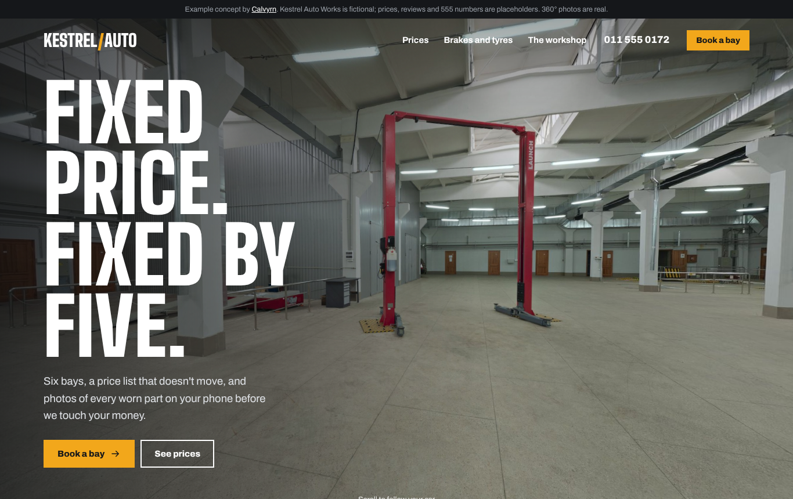
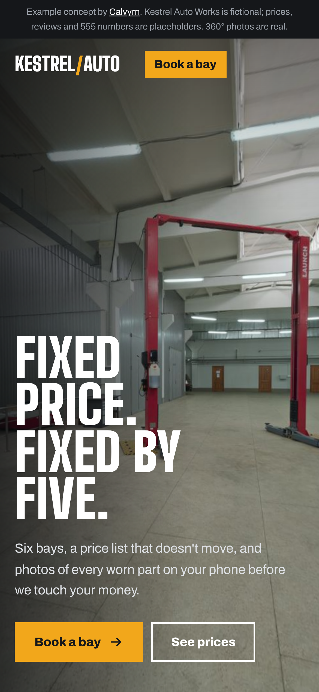

# Car workshop with fixed prices and bay booking

**Tier:** High-end 3D · **Industry:** Auto repair

Follow a car through a real workshop in 360°, with a job card that ticks off each stage as you scroll. Fixed service prices by car size, add-ons, a bay-by-time booking grid and a 3D photo of a brake disc.

**Live demo:** https://calvyrn.github.io/portfolio/sites/auto-service-360/

| Desktop | Phone |
|---|---|
|  |  |

**Why it matters:** People avoid workshops because they fear the bill. Fixed prices on the homepage and a slot they can book themselves remove both reasons to call around.

**Design:** Big Shoulders Display with Archivo; concrete, oil black, workshop blue and amber. Real 360 photos, scroll director, price menu, bay grid.

**How the 3D works:** the 360° views are real equirectangular photographs (Poly Haven, CC0) mapped inside a sphere; scrolling drives the camera and crossfades between rooms. The "3D photo" effect takes a real photo, estimates its depth with Depth Anything V2 (run offline), and displaces a dense mesh so the camera can move through it. Shared engine: [`shared/realview.js`](../../shared/realview.js).

The business, people, prices, reviews and phone numbers (555 numbers) are fictional placeholders. Photos: Unsplash.

---
Want this for your business? **info@calvyrn.com** · [calvyrn.com/contact.html](https://calvyrn.com/contact.html)
