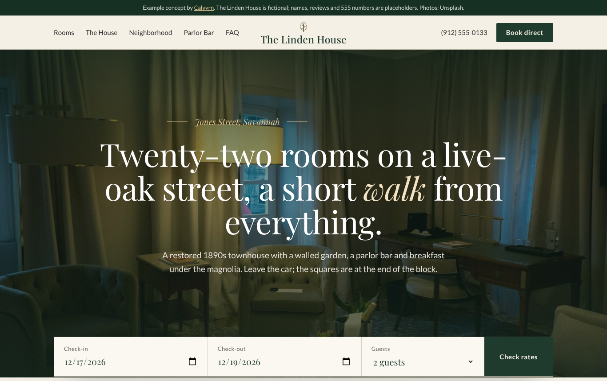
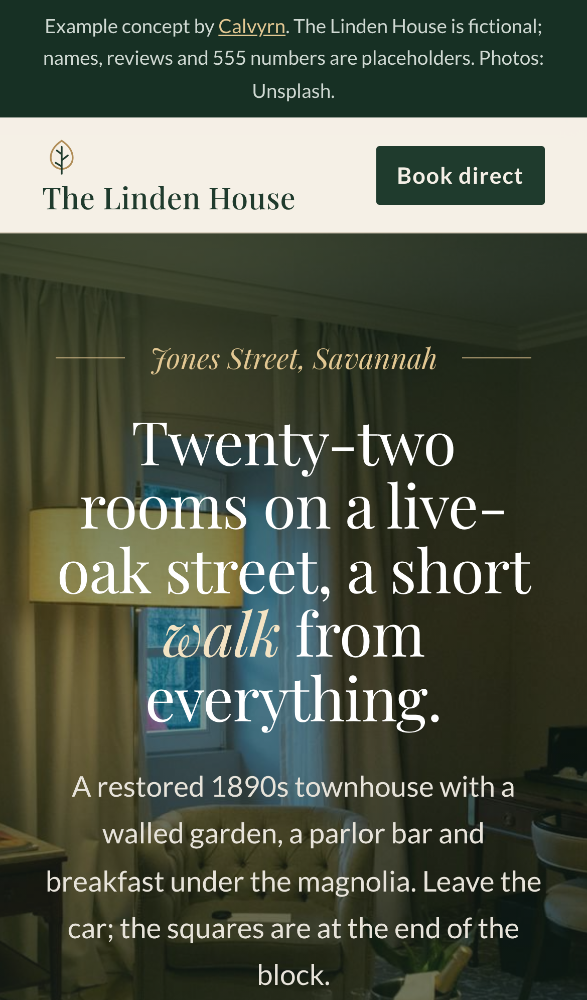

# Boutique hotel with direct booking

**Tier:** Medium · **Industry:** Hospitality

A 22-room Savannah boutique hotel site built around booking direct: date pickers with minimum dates, guests, room cards with nightly rates, a live total that prices weeknights and Friday/Saturday nights separately, a "book direct and get late checkout" perk and a confirmation state. Around it: rooms with sizes and beds, the house story, a five-spot walking guide, the bar and breakfast, FAQ and map.

**Live demo:** https://calvyrn.github.io/portfolio/sites/boutique-hotel/

| Desktop | Phone |
|---|---|
|  |  |

**Why it matters:** Every booking that comes through the hotel's own site instead of a booking platform avoids a commission, and a clear perk like late checkout gives guests a reason to book direct.

**Design:** Playfair Display + Lato; deep green, linen, brass, a touch of brick. Classic editorial layout with thin rules and a symmetrical hero. Single HTML file, no framework, keyboard accessible, responsive down to 320 px.

The business, reviews, rates and phone numbers (555 numbers) are fictional placeholders. Photos are free-licence images from Unsplash.

---
Want this for your business? **info@calvyrn.com** · [calvyrn.com/contact.html](https://calvyrn.com/contact.html)
