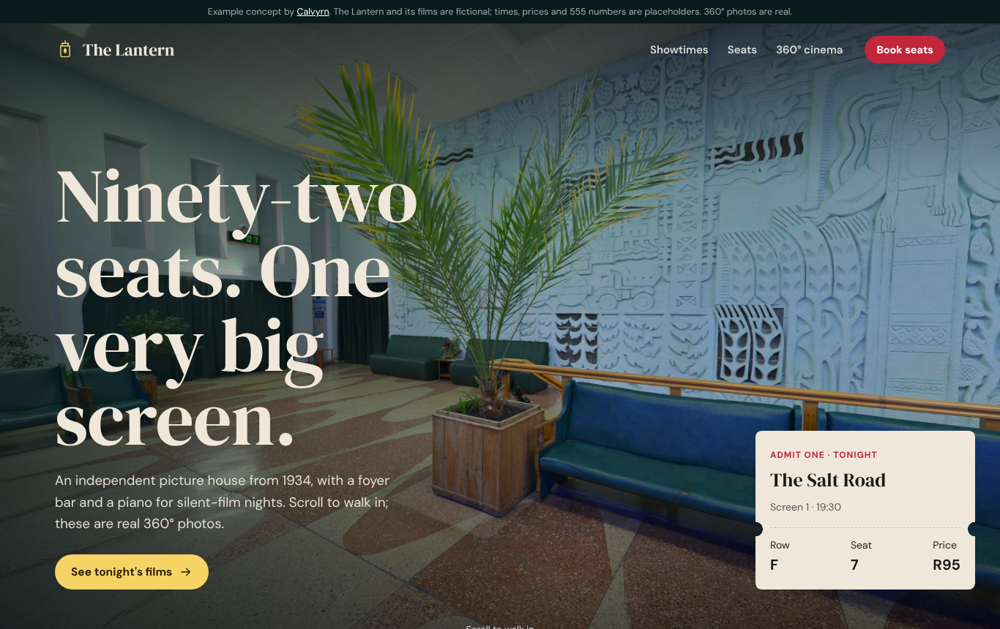
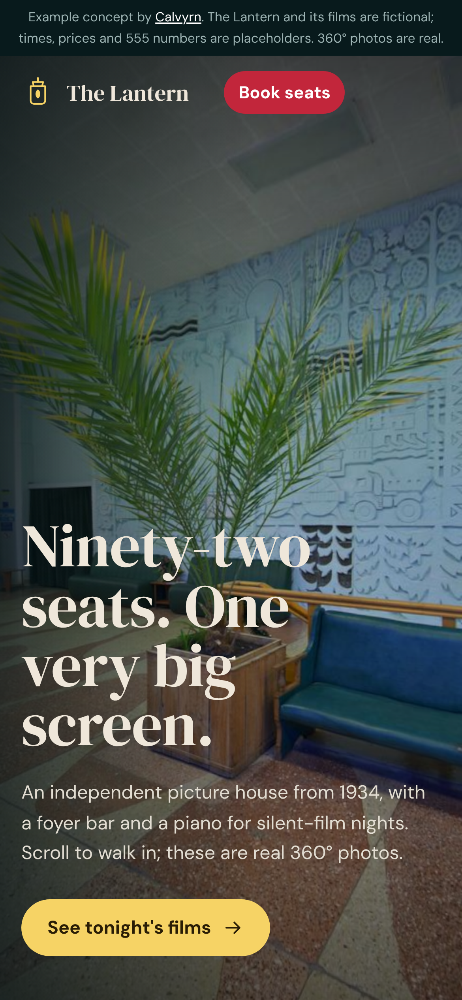

# Independent cinema with a seat picker

**Tier:** High-end 3D · **Industry:** Entertainment

Walk from the foyer bar into a real picture house in 360°. Showtimes by day, a seat map with love seats in the back row, snacks added to the order, and a 3D photo of the old projector.

**Live demo:** https://calvyrn.github.io/portfolio/sites/cinema-360/

| Desktop | Phone |
|---|---|
|  |  |

**Why it matters:** Small cinemas compete with streaming on atmosphere. Letting people see the room and pick their seat in two taps turns a maybe into a booking.

**Design:** DM Serif Display with DM Sans; teal, velvet red and corn. Real 360 photos, scroll director, seat map, snack cart.

**How the 3D works:** the 360° views are real equirectangular photographs (Poly Haven, CC0) mapped inside a sphere; scrolling drives the camera and crossfades between rooms. The "3D photo" effect takes a real photo, estimates its depth with Depth Anything V2 (run offline), and displaces a dense mesh so the camera can move through it. Shared engine: [`shared/realview.js`](../../shared/realview.js).

The business, people, prices, reviews and phone numbers (555 numbers) are fictional placeholders. Photos: Unsplash.

---
Want this for your business? **info@calvyrn.com** · [calvyrn.com/contact.html](https://calvyrn.com/contact.html)
