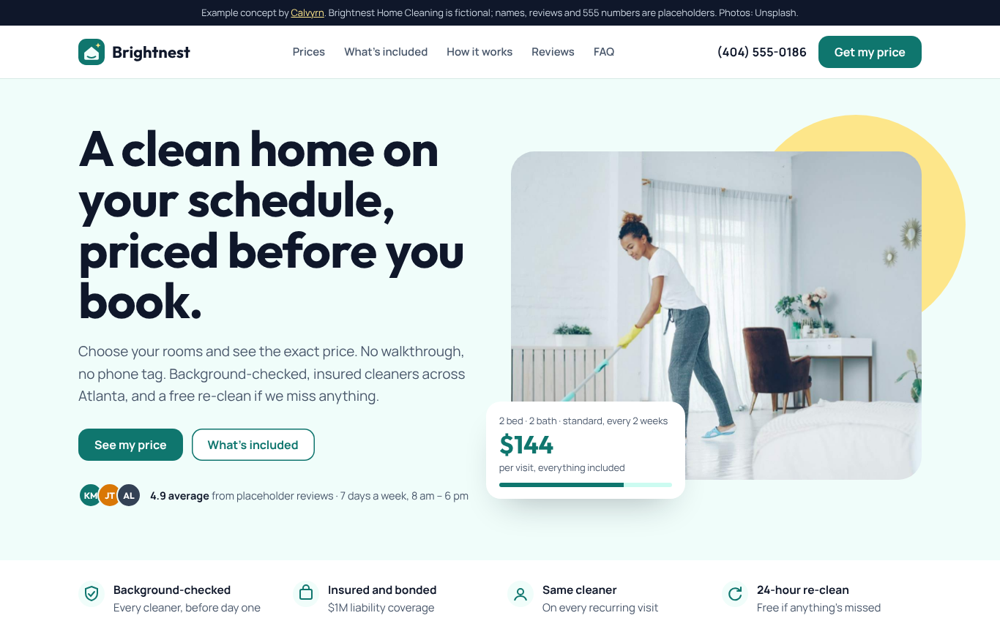
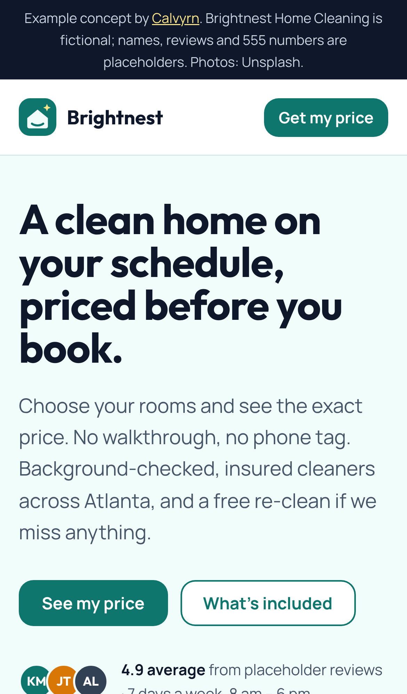

# Home cleaning with an instant price calculator

**Tier:** Medium · **Industry:** Home cleaning

Quote-first site for an Atlanta cleaning company: bedrooms, bathrooms, clean type, frequency discounts and add-ons update a live price in a sticky summary, then the customer picks a day, an arrival window and enters address and contact to get a booking confirmation. Also includes a tabbed "what's included" checklist, trust points, how it works, placeholder reviews, FAQ and service area.

**Live demo:** https://calvyrn.github.io/portfolio/sites/cleaning-quote/

| Desktop | Phone |
|---|---|
|  |  |

**Why it matters:** "How much will it cost?" is the first question every cleaning customer has. Answering it instantly, with the exact price and an open time, removes the call-back and the walkthrough that make people put off booking.

**Design:** Outfit + Manrope; teal, lemon and navy on white and mint. Friendly, airy layout with a sticky price summary on desktop and a price bar on phones. Single HTML file, no framework, keyboard accessible, responsive down to 360 px.

The business, people, reviews, prices and phone numbers (555 numbers) are fictional placeholders. Photos are free-licence images from Unsplash.

---
Want this for your business? **info@calvyrn.com** · [calvyrn.com/contact.html](https://calvyrn.com/contact.html)
