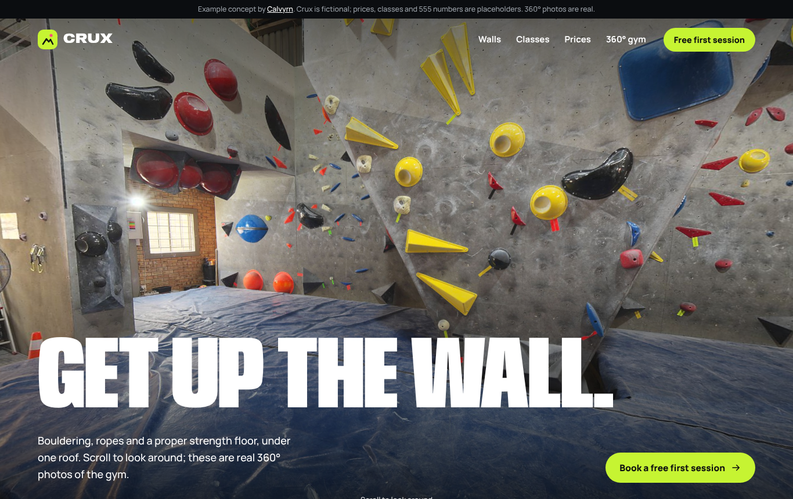
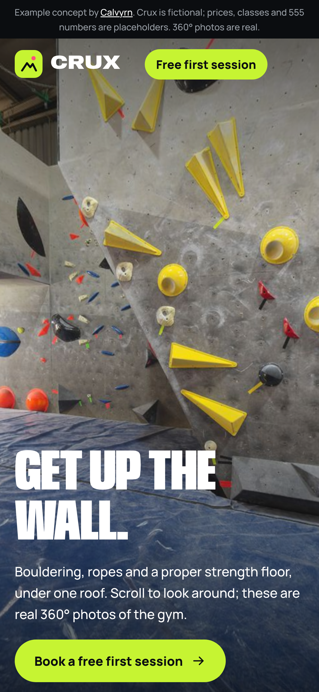

# Climbing and strength gym in real 360° with a free-session booking

**Tier:** High-end 3D · **Industry:** Fitness

Look up the real bouldering wall as you scroll, then cross into the strength floor, all in 360° photos. Colour-graded routes explained, a filterable class timetable, student pricing and a free first session picker.

**Live demo:** https://calvyrn.github.io/portfolio/sites/climbing-gym-360/

| Desktop | Phone |
|---|---|
|  |  |

**Why it matters:** First-timers are nervous about a climbing gym. Letting them look around the real walls and book a free coached session removes the fear of walking in.

**Design:** Anybody (narrow) with Manrope; chalk, electric blue, hold pink and lime. Real 360 photos, scroll director with pitch moves, depth-3D photos, timetable filters.

**How the 3D works:** the 360° views are real equirectangular photographs (Poly Haven, CC0) mapped inside a sphere; scrolling drives the camera and crossfades between rooms. The "3D photo" effect takes a real photo, estimates its depth with Depth Anything V2 (run offline), and displaces a dense mesh so the camera can move through it. Shared engine: [`shared/realview.js`](../../shared/realview.js).

The business, people, prices, reviews and phone numbers (555 numbers) are fictional placeholders. Photos: Unsplash.

---
Want this for your business? **info@calvyrn.com** · [calvyrn.com/contact.html](https://calvyrn.com/contact.html)
