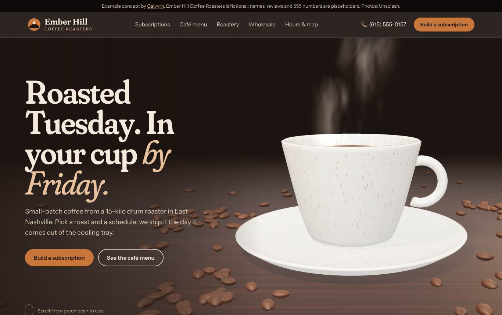
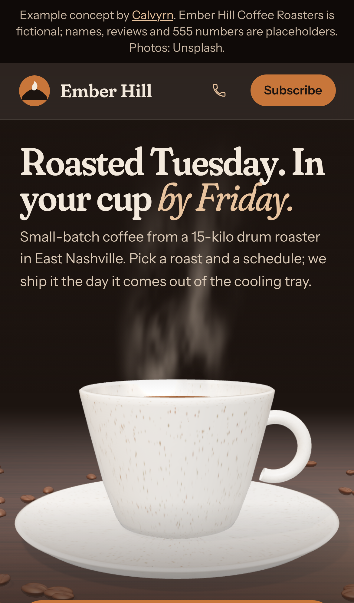

# Coffee roastery with a 3D scroll story and subscription builder

**Tier:** High-end 3D · **Industry:** Food & drink / e-commerce

Roastery, café and subscription site with a 3D scroll story: a speckled ceramic cup steams among procedural coffee beans, a copper hopper drops in and pours beans while grounds stream into the cup, then the camera dives into the coffee and moves through three roast chapters (Light, Medium, Dark) as beans and brew change colour and the tasting notes change. Below it, a working subscription builder (roast, grind, bag size, frequency, bags) with a live monthly price, cups-per-day estimate, validation and a confirmation screen. It also has the café menu, the roastery story, wholesale for offices, reviews, hours with today highlighted, and a map.

**Live demo:** https://calvyrn.github.io/portfolio/sites/coffee-roastery-3d/

| Desktop | Phone |
|---|---|
|  |  |

**Why it matters:** A subscription is a repeat order the roaster can plan around. A builder that shows the exact monthly price up front makes it easier for a visitor to commit.

**Design:** Fraunces (soft, optical sizes) + Instrument Sans; espresso, crema, copper roast, bark, sand. Three.js (LatheGeometry cup and hopper, instanced vertex-displaced beans, shader steam and coffee surface, soft shadows) and GSAP ScrollTrigger. Single HTML file, keyboard accessible, reduced-motion aware, responsive down to 360 px.

The business, people, reviews and phone numbers (555 numbers) are fictional placeholders. Photos are free-licence images from Unsplash.

---
Want this for your business? **info@calvyrn.com** · [calvyrn.com/contact.html](https://calvyrn.com/contact.html)
