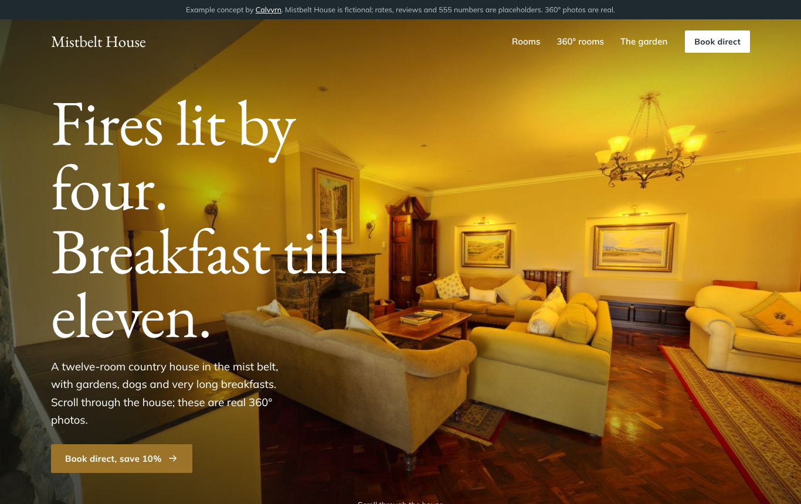
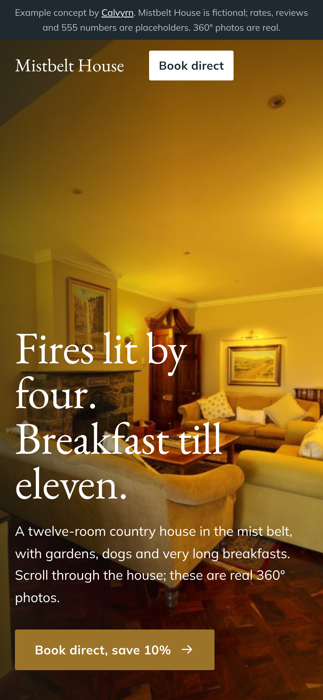

# Country house hotel with direct booking

**Tier:** High-end 3D · **Industry:** Hospitality

Scroll from the drawing room into the garden twin and the new-wing king in real 360° photos, with a room card for each. Walk any room in the tour, then book direct with nights, meal plans and the book-direct saving worked out live.

**Live demo:** https://calvyrn.github.io/portfolio/sites/country-house-hotel-360/

| Desktop | Phone |
|---|---|
|  |  |

**Why it matters:** Small hotels pay 15 to 20 percent to booking sites. A site that shows every room in 360° and prices the stay on the spot gives guests a reason to book direct.

**Design:** EB Garamond with Mulish; mist grey, ink and brass. Real 360 photos, scroll director, room tour, stay calculator.

**How the 3D works:** the 360° views are real equirectangular photographs (Poly Haven, CC0) mapped inside a sphere; scrolling drives the camera and crossfades between rooms. The "3D photo" effect takes a real photo, estimates its depth with Depth Anything V2 (run offline), and displaces a dense mesh so the camera can move through it. Shared engine: [`shared/realview.js`](../../shared/realview.js).

The business, people, prices, reviews and phone numbers (555 numbers) are fictional placeholders. Photos: Unsplash.

---
Want this for your business? **info@calvyrn.com** · [calvyrn.com/contact.html](https://calvyrn.com/contact.html)
