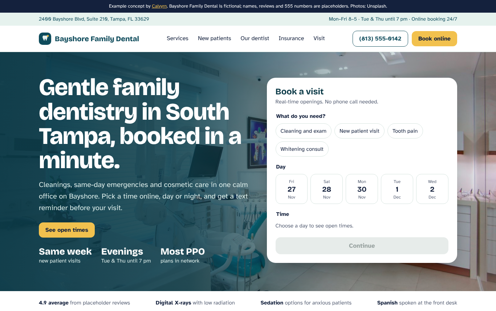
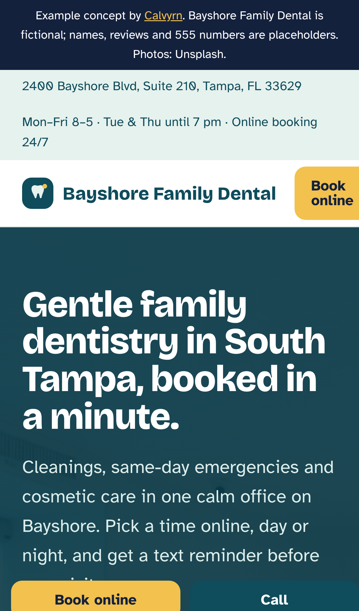

# Dental practice with online booking

**Tier:** Medium · **Industry:** Dental

Booking-first site: reason, day and live time slots, details and confirmation in under a minute, plus an after-hours assistant example.

**Live demo:** https://calvyrn.github.io/portfolio/sites/dental-booking/

| Desktop | Phone |
|---|---|
|  |  |

**Why it matters:** Zocdoc's data shows 48% of dental patients prefer to book between 5 p.m. and 9 a.m., when the office is closed.

**Design:** Bricolage Grotesque + Atkinson Hyperlegible; lagoon, enamel, sun. Single HTML file, no framework, keyboard accessible, responsive down to 360 px.

The business, people, reviews and phone numbers (555 numbers) are fictional placeholders. Photos are free-licence images from Unsplash.

---
Want this for your business? **info@calvyrn.com** · [calvyrn.com/contact.html](https://calvyrn.com/contact.html)
