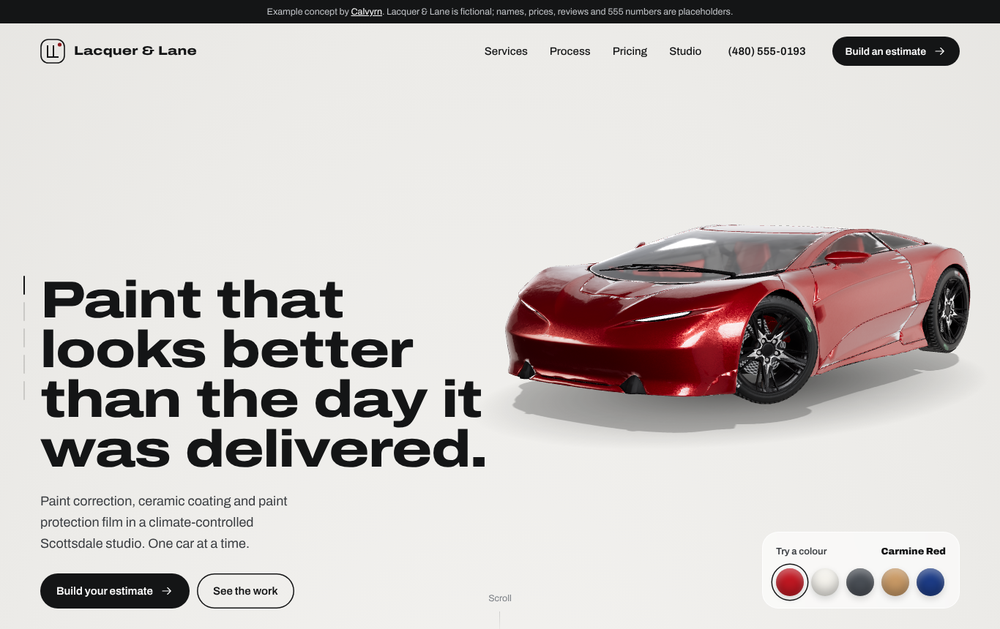
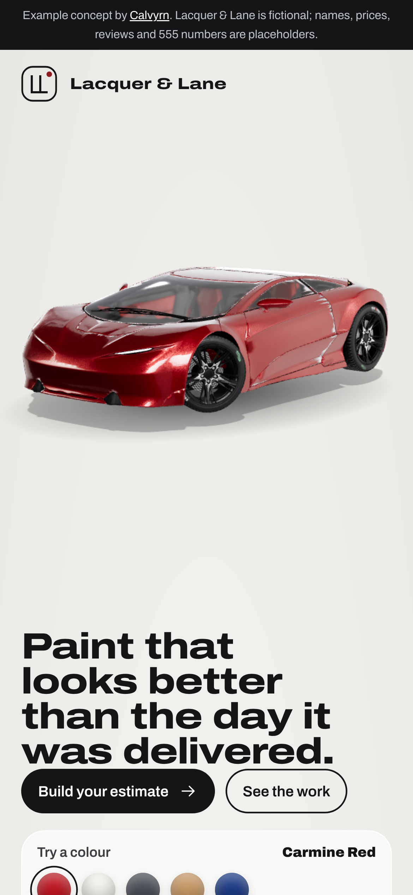

# Paint protection studio with a photoreal 3D car

**Tier:** High-end 3D · **Industry:** Automotive / detailing

The hero is a photoreal 3D sports car in a white studio, lit by a real HDRI so the clear coat shows true reflections and soft contact shadows. Pick a paint colour and the car repaints itself while the whole site's accent colour follows it. Scrolling drives a five-shot camera move around the car (front three-quarter, profile, nose, rear, overhead) with chapter cards for correction, ceramic coating, PPF and the Arizona climate, while the studio light sweeps across the paint. Below: a full-bleed 4K water-beading photo, a services grid with a custom icon set, the four-step process, a working estimate builder (vehicle, condition, services, live price range, studio days, weekday drop-off booking), reviews, FAQ and studio details.

**Live demo:** https://calvyrn.github.io/portfolio/sites/detailing-studio-3d/

| Desktop | Phone |
|---|---|
|  |  |

**Why it matters:** High-end detailing is sold on finish and trust. Letting an owner see paint reflections move, pick their own colour and get an honest price range before calling turns browsers into booked drop-offs.

**Design:** Archivo variable (expanded display, normal body); cyclorama grey, ink and a live paint-colour accent. Three.js with GLTF + Meshopt (2 MB model), RGBE studio lighting, PCF soft shadows, Lenis smooth scroll, preloader with real progress, responsive 4K images via srcset, reduced motion respected.

The business, people, prices, reviews and phone numbers (555 numbers) are fictional placeholders. 3D car: "CarConcept" by Darmstadt Graphics Group, CC BY 4.0, from the Khronos glTF sample assets (license plate replaced). Studio HDRI: Poly Haven, CC0. Photos: Unsplash.

---
Want this for your business? **info@calvyrn.com** · [calvyrn.com/contact.html](https://calvyrn.com/contact.html)
