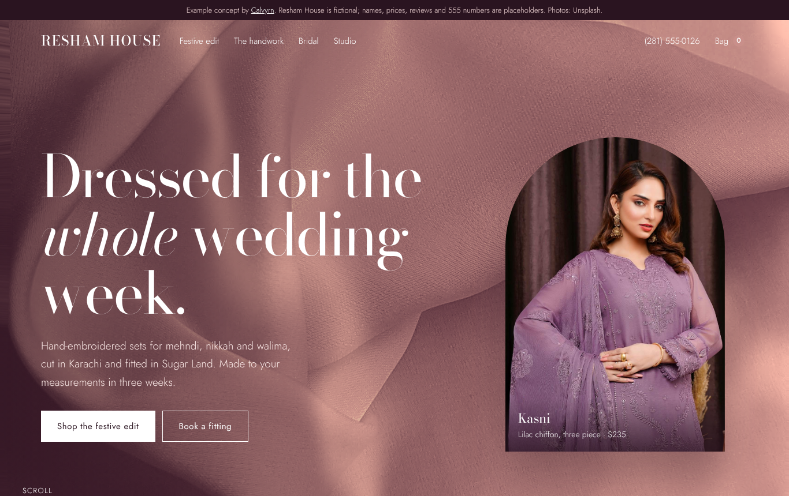
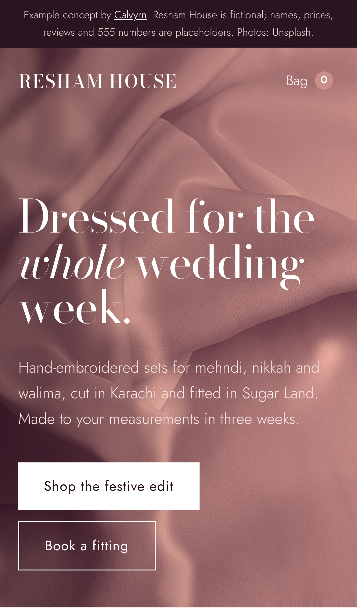

# Occasion-wear label with a motion hero and scroll-driven lookbook

**Tier:** High-end 3D · **Industry:** Fashion / ecommerce

A premium "motion site" for a South Asian occasion-wear studio. The hero background is a live WebGL shader that makes a silk photo ripple, catch light and follow the cursor, tinted to the brand's dusty rose. Below it, a pinned horizontal lookbook scrolls sideways, and a pinned close-up zooms into the embroidery while captions walk through the neckline, sleeves, dupatta border and fabric. Working shop flow: quick view, size or made-to-measure with measurement checks, bag with subtotal, and a fitting-room reservation that blocks Mondays.

**Live demo:** https://calvyrn.github.io/portfolio/sites/eastern-wear-motion/

| Desktop | Phone |
|---|---|
|  |  |

**Why it matters:** For occasion wear, buyers want to see the handwork before they spend. Motion and close-ups show the craft the way a reel does, and the try-on reservation turns browsers into store visits.

**Design:** Bodoni Moda + Jost; plum, dusty rose, blush and antique gold. Custom fragment shader (no video file to download), GSAP ScrollTrigger pins, accessible drawers with Escape to close, reduced motion respected, responsive down to 360 px.

The business, people, prices, reviews and phone numbers (555 numbers) are fictional placeholders. Photos are free-licence images from Unsplash.

---
Want this for your business? **info@calvyrn.com** · [calvyrn.com/contact.html](https://calvyrn.com/contact.html)
