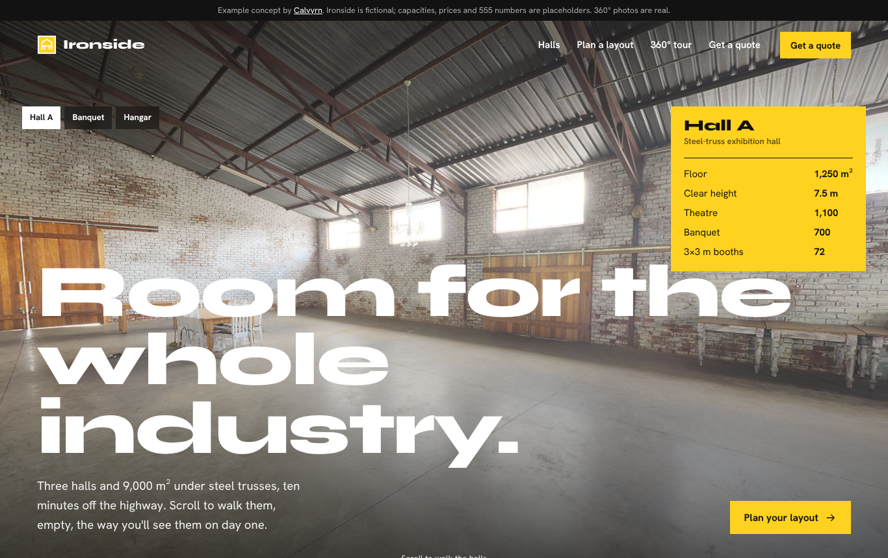
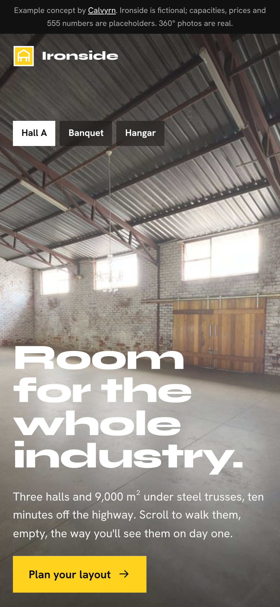

# Expo and convention centre with 360° site visits and a layout planner

**Tier:** High-end 3D · **Industry:** Events

Walk three real halls in 360° as you scroll, with live specs for each. A layout planner draws a to-scale floor plan for theatre, banquet, classroom or expo booths and checks the fit; then an instant estimate with hall recommendation.

**Live demo:** https://calvyrn.github.io/portfolio/sites/event-venue-360/

| Desktop | Phone |
|---|---|
|  |  |

**Why it matters:** Event planners can't visit every venue. A real 360° site visit, a plan that proves it fits and a price on the spot shortlist the venue before the first call.

**Design:** Syne with Hanken Grotesk; concrete and safety yellow. Real 360 photos, scroll director, SVG floor-plan generator, depth-3D photos, quote calculator.

**How the 3D works:** the 360° views are real equirectangular photographs (Poly Haven, CC0) mapped inside a sphere; scrolling drives the camera and crossfades between rooms. The "3D photo" effect takes a real photo, estimates its depth with Depth Anything V2 (run offline), and displaces a dense mesh so the camera can move through it. Shared engine: [`shared/realview.js`](../../shared/realview.js).

The business, people, prices, reviews and phone numbers (555 numbers) are fictional placeholders. Photos: Unsplash.

---
Want this for your business? **info@calvyrn.com** · [calvyrn.com/contact.html](https://calvyrn.com/contact.html)
