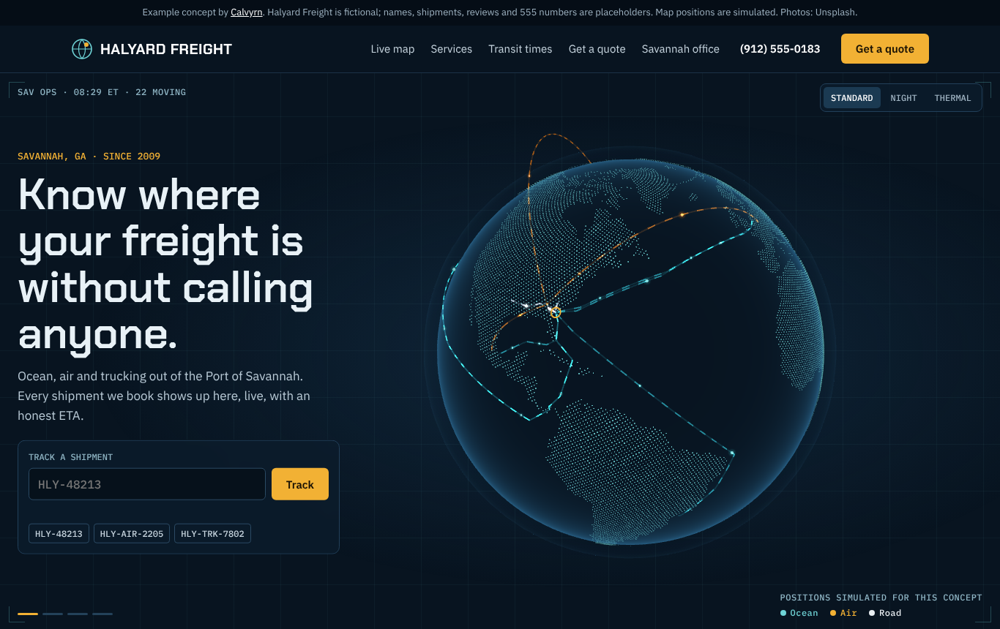
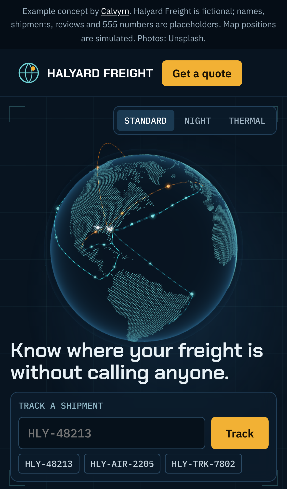

# Freight forwarder with a live 3D shipment globe

**Tier:** High-end 3D · **Industry:** Logistics / freight

An ops-room style globe built with Three.js: 16,000 land dots, ocean lanes via Panama and across the Atlantic, air arcs and truck routes, with vessels, flights and trucks moving along them. Type or click a tracking number and the camera follows that shipment while a card shows carrier, cargo, live position, ETA and milestones. Map styles switch between Standard, Night and Thermal. Scrolling walks through ocean, air and road, dimming the other lanes. Below: services, transit-time table, a validated quote request, FAQ and office map.

**Live demo:** https://calvyrn.github.io/portfolio/sites/freight-globe-3d/

| Desktop | Phone |
|---|---|
|  |  |

**Why it matters:** Importers spend hours emailing for container updates. A tracking page they can open and forward saves those calls and makes a small forwarder look as capable as a big one.

**Design:** Chakra Petch + IBM Plex Sans/Mono; harbor navy, sea cyan, signal amber. Custom shaders for land dots, atmosphere, animated dashed routes and moving assets. Drag to rotate, click to track, reduced motion respected, responsive down to 360 px. Inspired by open-source spatial-intelligence globes such as God's Eye View.

The business, people, shipments, reviews and phone numbers (555 numbers) are fictional placeholders and map positions are simulated. Photos are free-licence images from Unsplash. Land outline from Natural Earth (public domain).

---
Want this for your business? **info@calvyrn.com** · [calvyrn.com/contact.html](https://calvyrn.com/contact.html)
