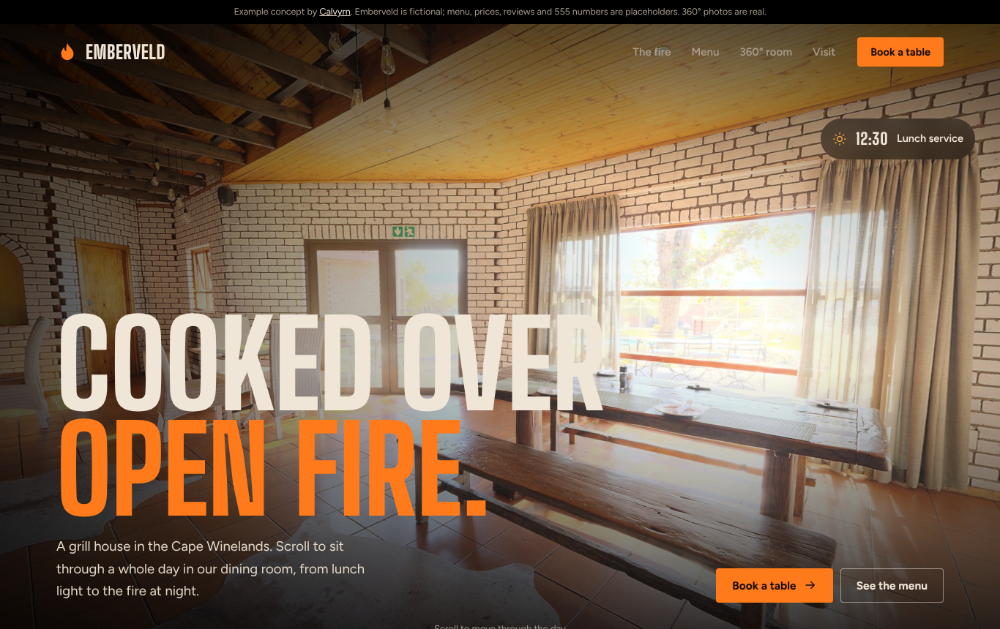
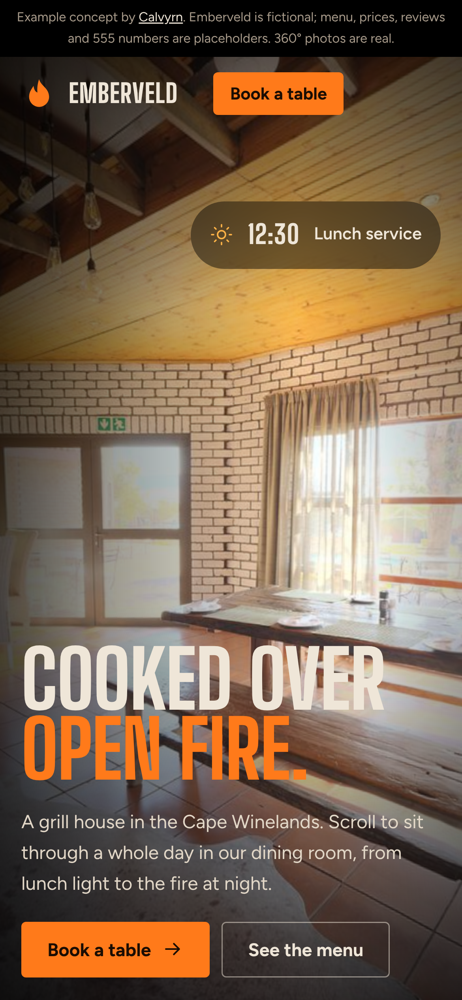

# Grill house you can see by day and by night in 360°

**Tier:** High-end 3D · **Industry:** Restaurant

Scroll through a whole day in the real dining room: lunch light crossfades into the same room after dark, then into the bar. A lunch/dinner switch in the 360° tour, depth-3D food photos, a tabbed menu and a table booking with live time slots.

**Live demo:** https://calvyrn.github.io/portfolio/sites/grill-house-360/

| Desktop | Phone |
|---|---|
|  |  |

**Why it matters:** Diners pick restaurants on atmosphere. Showing the real room at the hour they'll eat, and letting them choose the fireside table, turns a browse into a booking.

**Design:** Big Shoulders Display with Figtree; coal and ember. Real day and night 360 photos of the same room, scroll director with crossfades, depth-3D photos, Lenis, custom icons.

**How the 3D works:** the 360° views are real equirectangular photographs (Poly Haven, CC0) mapped inside a sphere; scrolling drives the camera and crossfades between rooms. The "3D photo" effect takes a real photo, estimates its depth with Depth Anything V2 (run offline), and displaces a dense mesh so the camera can move through it. Shared engine: [`shared/realview.js`](../../shared/realview.js).

The business, people, prices, reviews and phone numbers (555 numbers) are fictional placeholders. Photos: Unsplash.

---
Want this for your business? **info@calvyrn.com** · [calvyrn.com/contact.html](https://calvyrn.com/contact.html)
