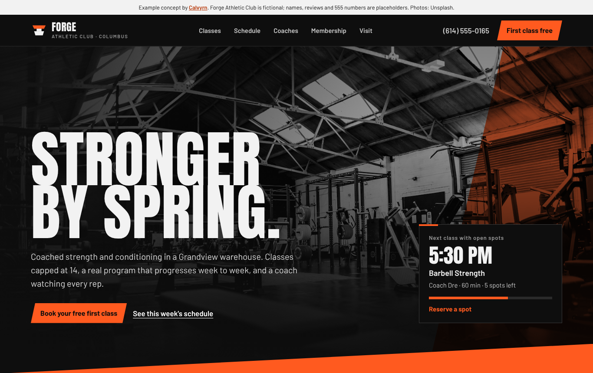
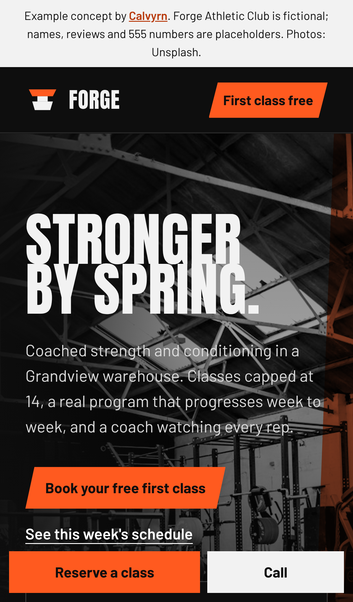

# Strength gym with class booking

**Tier:** Medium · **Industry:** Fitness

A dark, high-contrast gym site with a working weekly schedule: filter by class type, coach and time of day, reserve a spot and watch the spots-left count drop, join a waitlist when a class is full, and see your bookings appear in a CSS phone mockup of the member app. It also has a monthly/annual membership toggle and a free-first-class sign-up.

**Live demo:** https://calvyrn.github.io/portfolio/sites/gym-studio/

| Desktop | Phone |
|---|---|
|  |  |

**Why it matters:** Most people decide on a gym from their phone, and the first thing they want is the schedule. Showing real open spots and letting them book a free class on the spot turns a browsing visitor into someone standing at the door.

**Design:** Anton (condensed caps for headings) + Barlow; black, forge orange, steel, ash. Diagonal section edges, oversized type, grayscale photography. Single HTML file, no framework, keyboard accessible, respects reduced motion, responsive down to 360 px.

The business, people, stories, reviews and phone numbers (555 numbers) are fictional placeholders. Photos are free-licence images from Unsplash.

---
Want this for your business? **info@calvyrn.com** · [calvyrn.com/contact.html](https://calvyrn.com/contact.html)
