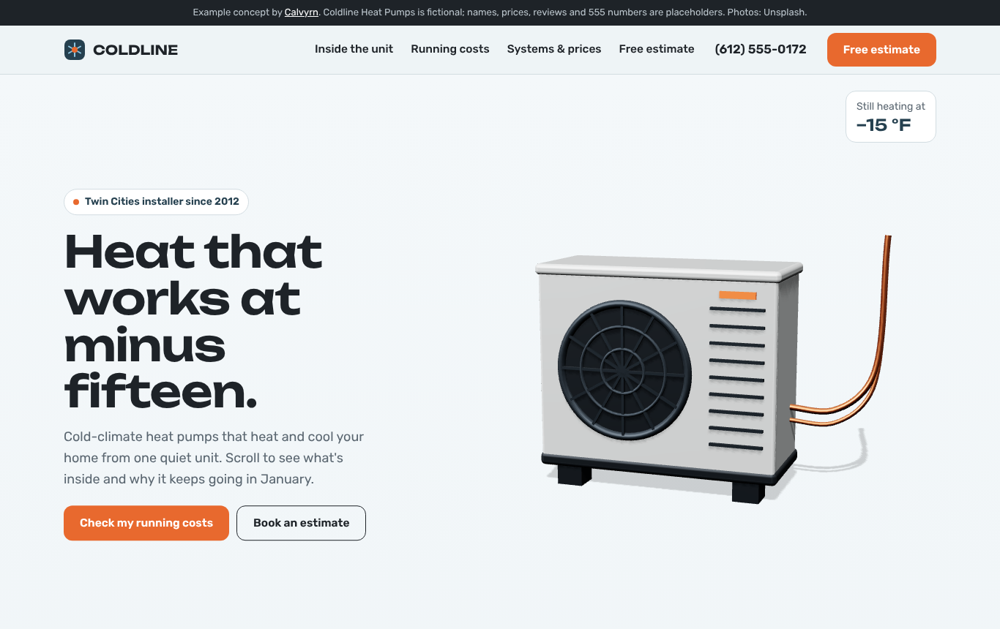
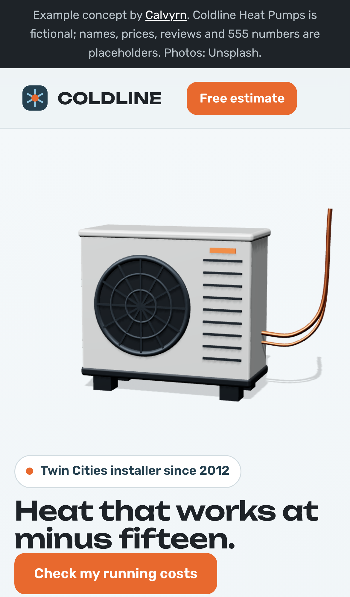

# Heat pump installer with a scroll-driven exploded 3D unit

**Tier:** High-end 3D · **Industry:** HVAC / home services

A cold-climate heat pump built in Three.js sits in the hero. As you scroll, the unit comes apart in stages, the cabinet and grille, the variable-speed fan, the coil, the inverter compressor, the defrost board and the copper line set, each with a label that tracks the part in 3D and copy explaining why it keeps heating at −15 °F. Below it, an honest running-cost calculator compares the home's current fuel with a heat pump or hybrid setup (and says when gas is still cheaper), and the result is attached to a validated estimate booking.

**Live demo:** https://calvyrn.github.io/portfolio/sites/heatpump-exploded-3d/

| Desktop | Phone |
|---|---|
|  |  |

**Why it matters:** Homeowners in cold states doubt heat pumps work in winter. Showing what's inside, and giving straight numbers for their own house, earns trust that a brochure can't.

**Design:** Unbounded + Rubik; frost, graphite, heat orange, ice blue. Procedural unit with rounded panels, instanced coil fins and copper tubes, staged explode on scroll, screen-tracked labels, reduced motion respected, responsive down to 360 px. Inspired by "product breakdown" style reels.

The business, people, prices, reviews and phone numbers (555 numbers) are fictional placeholders, and savings are illustrative. Photos are free-licence images from Unsplash.

---
Want this for your business? **info@calvyrn.com** · [calvyrn.com/contact.html](https://calvyrn.com/contact.html)
