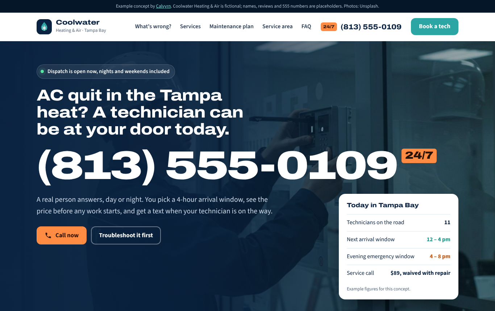
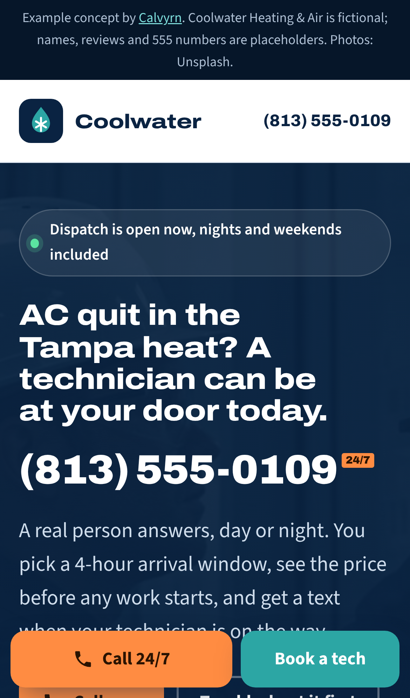

# 24/7 HVAC company with a "What's wrong?" troubleshooter

**Tier:** Medium · **Industry:** HVAC / home services

Call-first site for an emergency heating and air company: a giant tap-to-call number in the hero, and a troubleshooter that walks homeowners through 2–3 safe checks per symptom before booking a technician in an arrival window, with after-hours fees shown up front and a tech-on-the-way confirmation.

**Live demo:** https://calvyrn.github.io/portfolio/sites/hvac-emergency/

| Desktop | Phone |
|---|---|
|  |  |

**Why it matters:** People with a broken AC want a phone number and an arrival time, fast. Safe self-checks solve the simple cases (and earn goodwill), while real problems become booked jobs instead of missed calls.

**Design:** Archivo (expanded) + Source Sans 3; navy, teal and a hot orange kept only for emergency actions. Icon row, sticky mobile call bar, single HTML file, no framework, keyboard accessible, responsive down to 360 px.

The business, people, reviews and phone numbers (555 numbers) are fictional placeholders. Photos are free-licence images from Unsplash.

---
Want this for your business? **info@calvyrn.com** · [calvyrn.com/contact.html](https://calvyrn.com/contact.html)
