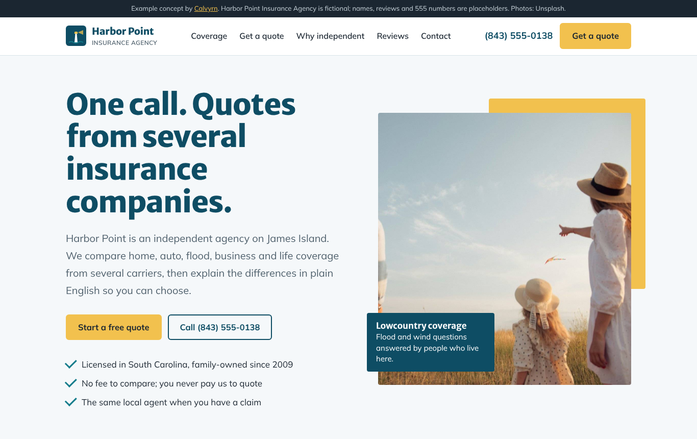
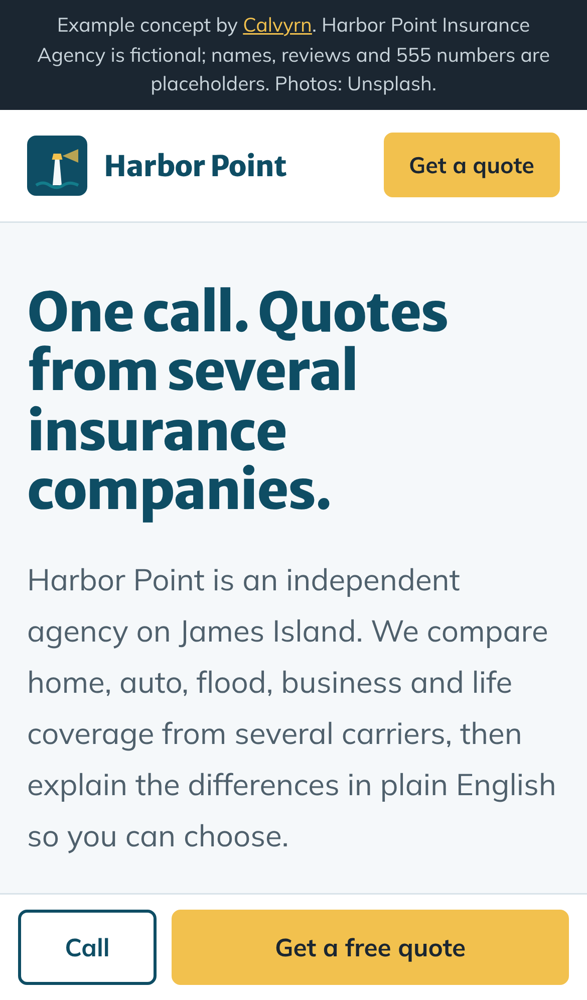

# Independent insurance agency with a 3-step quote request

**Tier:** Simple · **Industry:** Insurance

One clear page for an independent agency: the "compare quotes from several carriers" promise with an example comparison, a tidy coverage list (home, auto, flood, business, life), and a three-step quote request (coverage type, ZIP and basics that adapt to the coverage chosen, contact) with validation and a confirmation. Plus why use an independent agent, reviews, FAQ, hours and map.

**Live demo:** https://calvyrn.github.io/portfolio/sites/insurance-agency/

| Desktop | Phone |
|---|---|
|  |  |

**Why it matters:** An independent agency's advantage is choice, but most agency sites never show it. Explaining the comparison and collecting just enough to quote, in a short form, gives the agent a warm lead instead of a missed call.

**Design:** Merriweather Sans + Mulish; harbor blue, fog, beacon yellow, sea teal. Simple, very readable layout with large body text. Single HTML file, no framework, keyboard accessible, responsive down to 360 px, images under 400 KB in total.

The business, people, reviews and phone numbers (555 numbers) are fictional placeholders. Carrier names in the comparison are placeholders. Photos are free-licence images from Unsplash.

---
Want this for your business? **info@calvyrn.com** · [calvyrn.com/contact.html](https://calvyrn.com/contact.html)
