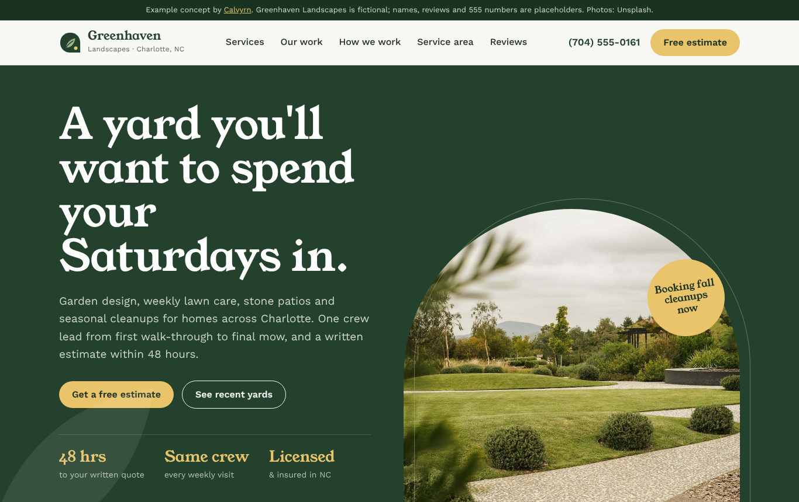
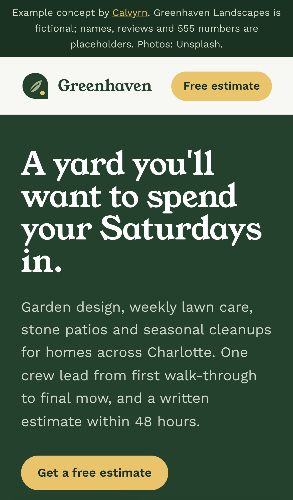

# Landscaping company with a free-estimate form

**Tier:** Simple · **Industry:** Landscaping

A fast, image-led one-page site for a Charlotte landscaper: arch-framed hero, four services with starting prices, a captioned project gallery, a four-step process, service area with map, and a short estimate form (service, yard size, address, contact, optional photos that stay on the device) with a clear confirmation.

**Live demo:** https://calvyrn.github.io/portfolio/sites/landscaping-simple/

| Desktop | Phone |
|---|---|
|  |  |

**Why it matters:** Most landscaping leads start with "how much?". A short form that asks only what the crew needs to quote (service, yard size, address, a photo) gets more requests than a phone number alone, and gives the crew lead what they need before the call.

**Design:** Young Serif + Work Sans; deep leaf, sage, bark and sun on a soft off-white. Arch and organic shapes, all images under 1 MB in total. Single HTML file, no framework, keyboard accessible, responsive down to 360 px.

The business, people, reviews and phone numbers (555 numbers) are fictional placeholders. Photos are free-licence images from Unsplash.

---
Want this for your business? **info@calvyrn.com** · [calvyrn.com/contact.html](https://calvyrn.com/contact.html)
