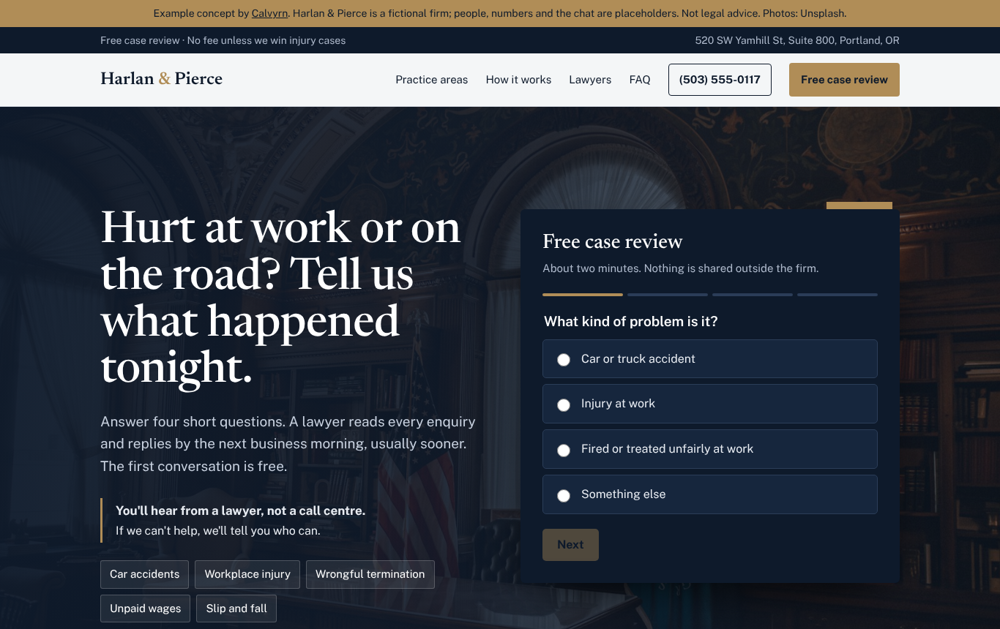
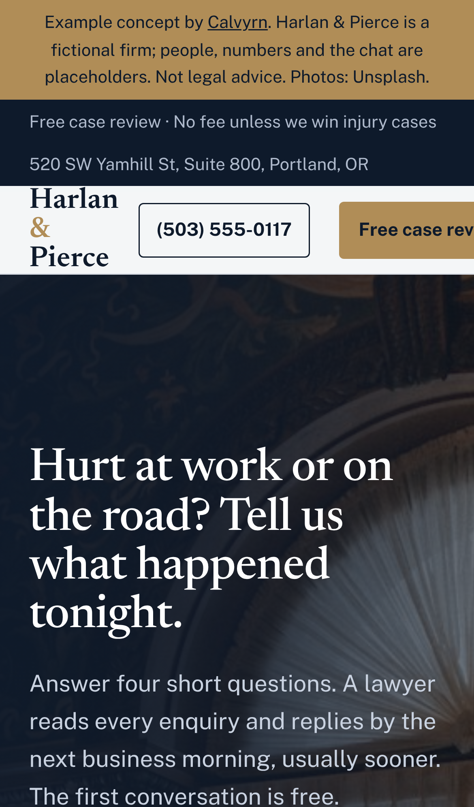

# Law firm with 24/7 guided intake

**Tier:** Medium · **Industry:** Legal

Four-step case review (type, date, story, contact) with progress, validation and a clear what-happens-next section; after-hours assistant that never gives legal advice.

**Live demo:** https://calvyrn.github.io/portfolio/sites/law-intake/

| Desktop | Phone |
|---|---|
|  |  |

**Why it matters:** Clio's 2024 Legal Trends Report found only 40% of law firms answered calls from prospective clients.

**Design:** Newsreader + Public Sans; navy, brass. Single HTML file, no framework, keyboard accessible, responsive down to 360 px.

The business, people, reviews and phone numbers (555 numbers) are fictional placeholders. Photos are free-licence images from Unsplash.

---
Want this for your business? **info@calvyrn.com** · [calvyrn.com/contact.html](https://calvyrn.com/contact.html)
