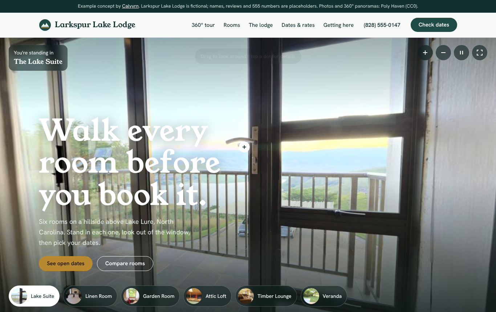
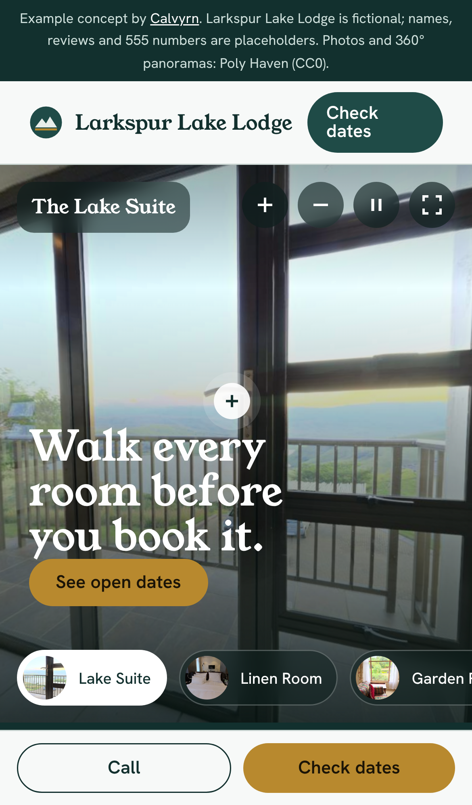

# Lake lodge with a walk-through 360° tour of every room

**Tier:** High-end 3D · **Industry:** Hospitality / vacation rentals

The hero is a real 360° room tour built with Three.js: drag to look around, pinch or use the buttons to zoom, tap dots for room details, and follow brass arrows from one room to the next with a crossfade. Six rooms, each with a still for the room cards. Below it, a direct-booking form works out nights, weekend rates and cleaning fee live, checks the two-night weekend rule and confirms the request.

**Live demo:** https://calvyrn.github.io/portfolio/sites/lodge-360-tour/

| Desktop | Phone |
|---|---|
|  |  |

**Why it matters:** Guests can see the actual bed, window and view before they pay, so they book direct with more confidence instead of through a booking site that takes a fee.

**Design:** Young Serif + Hanken Grotesk; lake ink, fog, moss and brass. Single HTML file, Three.js 0.164 sphere viewer with HTML hotspots, keyboard arrows, reduced motion respected, responsive down to 360 px.

The business, people, reviews and phone numbers (555 numbers) are fictional placeholders. Photos and 360° panoramas are CC0 from Poly Haven.

---
Want this for your business? **info@calvyrn.com** · [calvyrn.com/contact.html](https://calvyrn.com/contact.html)
