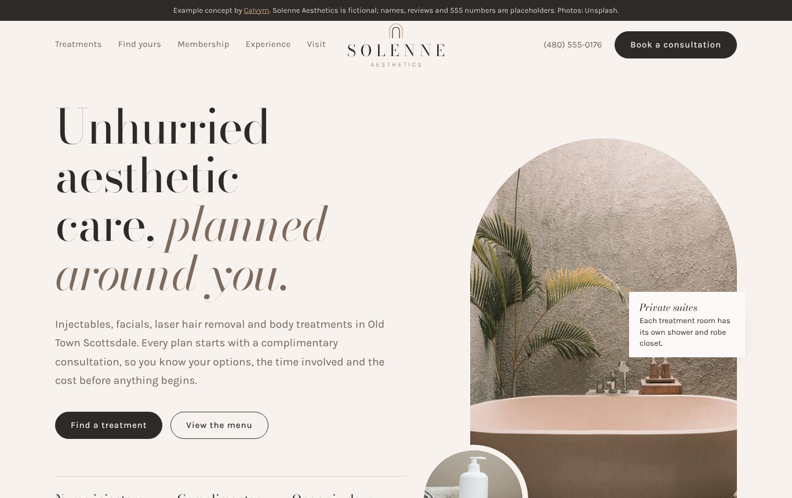
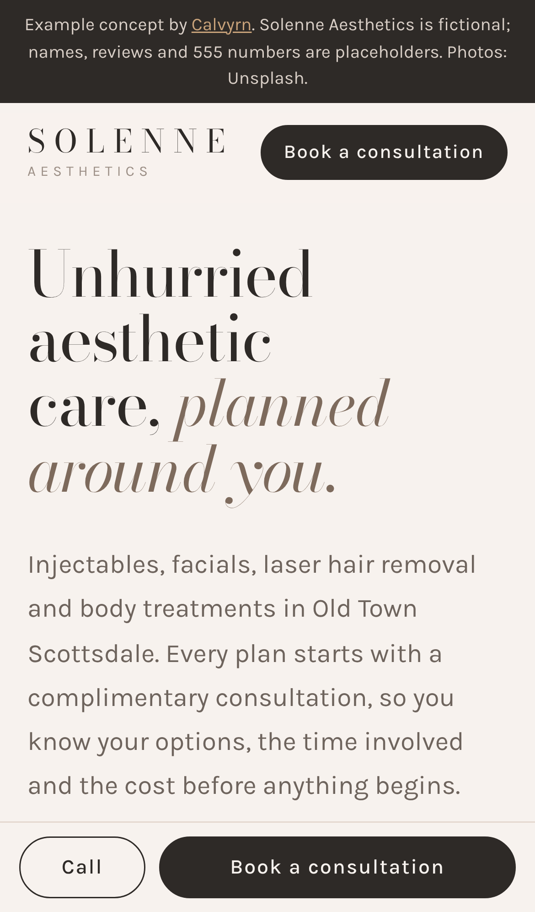

# Med spa with a treatment finder

**Tier:** Medium · **Industry:** Med spa / aesthetics

Consultation-first site for a med spa: visitors pick a concern (fine lines, skin texture, hair removal, body contouring, relaxation), see suggested treatments with time and starting price, choose a nurse injector or aesthetician (only the providers who can perform that treatment are offered), pick a day and time and send a consultation request. Clear wording throughout that every treatment needs a consultation and results vary, with no medical claims.

**Live demo:** https://calvyrn.github.io/portfolio/sites/med-spa/

| Desktop | Phone |
|---|---|
|  |  |

**Why it matters:** Most people arrive at a med spa site knowing what bothers them, not which treatment it needs. Starting from the concern, and showing time and starting price up front, turns browsing into a booked consultation without pressure.

**Design:** Bodoni Moda + Karla; blush ivory, espresso ink, champagne, sand. Tall arch photo crops, lots of air. Single HTML file, no framework, keyboard accessible, reduced-motion aware, responsive down to 360 px.

The business, people, reviews and phone numbers (555 numbers) are fictional placeholders. Photos are free-licence images from Unsplash.

---
Want this for your business? **info@calvyrn.com** · [calvyrn.com/contact.html](https://calvyrn.com/contact.html)
