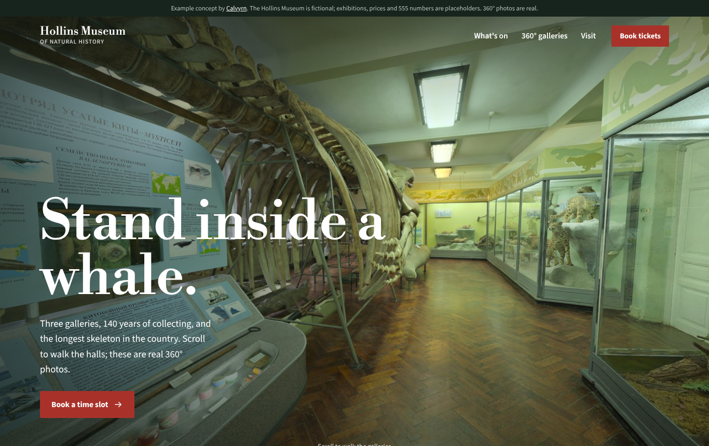
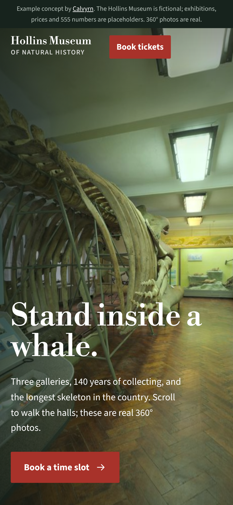

# Natural history museum with timed tickets

**Tier:** High-end 3D · **Industry:** Culture

Scroll from the mammal hall into the ribs of a real whale skeleton and on to the fish gallery, all in real 360° photos with specimen labels that appear as you go. Timed entry tickets with live capacity, ticket types and a family price.

**Live demo:** https://calvyrn.github.io/portfolio/sites/natural-history-museum-360/

| Desktop | Phone |
|---|---|
|  |  |

**Why it matters:** Museums lose visitors at the ticket desk queue. Showing the best room first and selling a time slot online fills quiet hours and shortens the line.

**Design:** Libre Bodoni with Source Sans 3; celadon, ink and label red. Real 360 photos, scroll director, info hotspots, timed ticketing.

**How the 3D works:** the 360° views are real equirectangular photographs (Poly Haven, CC0) mapped inside a sphere; scrolling drives the camera and crossfades between rooms. The "3D photo" effect takes a real photo, estimates its depth with Depth Anything V2 (run offline), and displaces a dense mesh so the camera can move through it. Shared engine: [`shared/realview.js`](../../shared/realview.js).

The business, people, prices, reviews and phone numbers (555 numbers) are fictional placeholders. Photos: Unsplash.

---
Want this for your business? **info@calvyrn.com** · [calvyrn.com/contact.html](https://calvyrn.com/contact.html)
