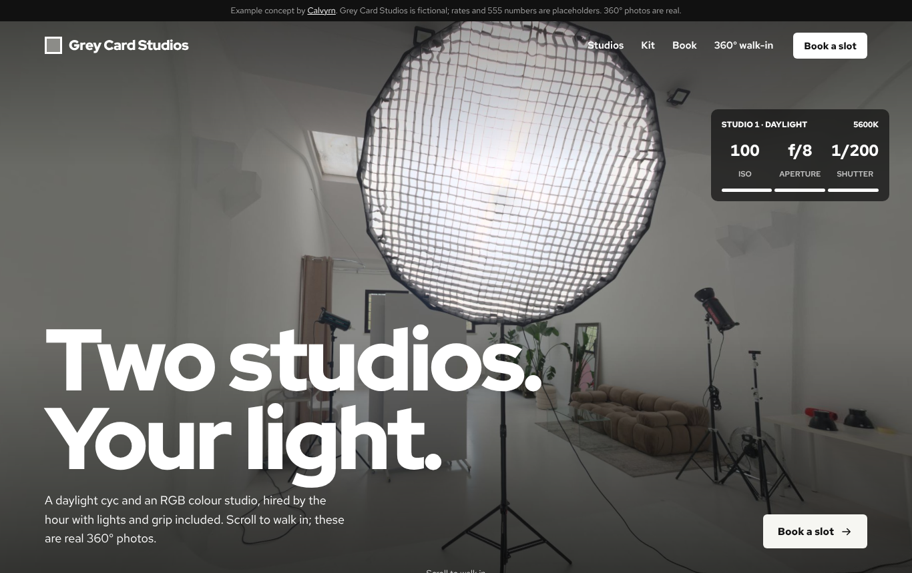
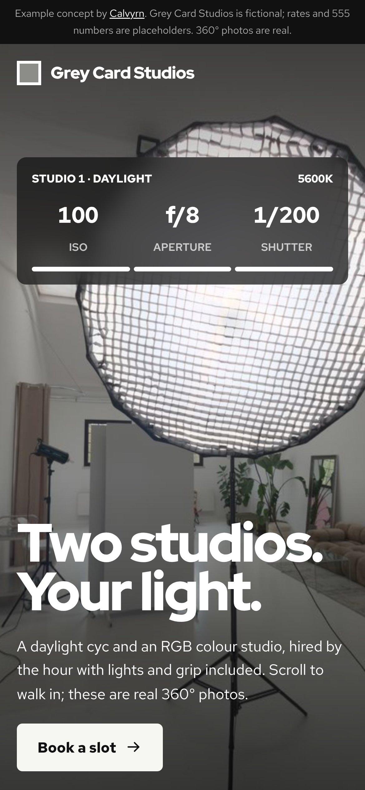

# Photo studio hire with a light meter that follows the 360° view

**Tier:** High-end 3D · **Industry:** Photography

Walk a white cyc studio and an RGB colour studio in real 360° photos while a light meter reads the scene. Studio specs, a kit list you can add to the booking, and a timeline booking that shows existing bookings and catches clashes.

**Live demo:** https://calvyrn.github.io/portfolio/sites/photo-studio-360/

| Desktop | Phone |
|---|---|
|  |  |

**Why it matters:** Photographers book studios on space and light. Seeing both rooms, the kit and a free slot in one place turns an enquiry into an hour booked.

**Design:** Red Hat Display and Text on 18% grey card; real 360 photos, scroll director, live 'light meter', depth-3D photos, timeline booking with clash detection.

**How the 3D works:** the 360° views are real equirectangular photographs (Poly Haven, CC0) mapped inside a sphere; scrolling drives the camera and crossfades between rooms. The "3D photo" effect takes a real photo, estimates its depth with Depth Anything V2 (run offline), and displaces a dense mesh so the camera can move through it. Shared engine: [`shared/realview.js`](../../shared/realview.js).

The business, people, prices, reviews and phone numbers (555 numbers) are fictional placeholders. Photos: Unsplash.

---
Want this for your business? **info@calvyrn.com** · [calvyrn.com/contact.html](https://calvyrn.com/contact.html)
