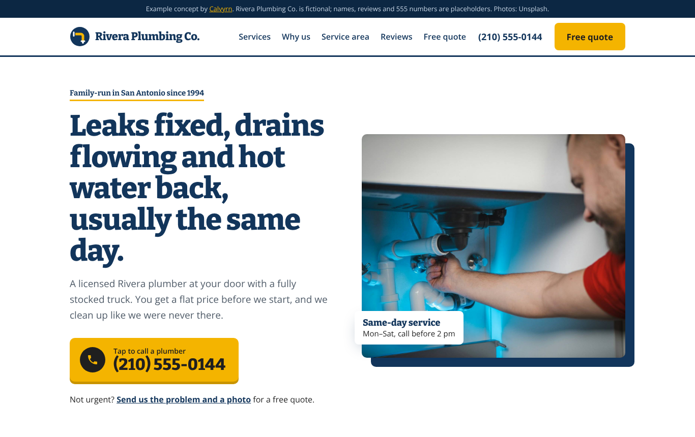
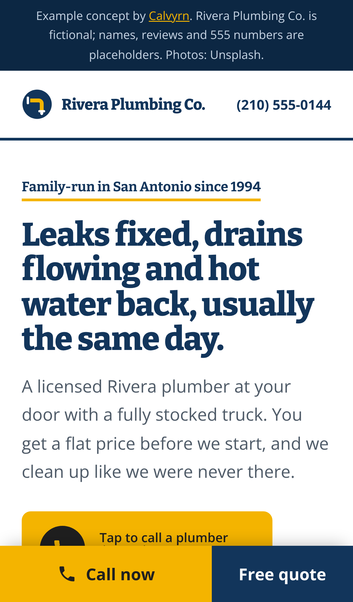

# Family plumber with a quick quote form

**Tier:** Simple · **Industry:** Plumbing

Fast one-page site for a local plumber: a big tap-to-call button, six services with starting prices, why us, service area and hours, reviews, and a short quote form (name, phone, problem, optional photo preview that stays on the device) with validation and a confirmation.

**Live demo:** https://calvyrn.github.io/portfolio/sites/plumbing-simple/

| Desktop | Phone |
|---|---|
|  |  |

**Why it matters:** Most plumbing customers are on a phone with a problem right now. A light page that loads fast and puts the call button and a two-minute quote form first turns that visit into a job.

**Design:** Bitter (slab) + Open Sans; pipe blue, brass and white. Simple stacked sections, large tap targets, under 350 KB of images, single HTML file, no framework, keyboard accessible, responsive down to 360 px.

The business, people, reviews and phone numbers (555 numbers) are fictional placeholders. Photos are free-licence images from Unsplash.

---
Want this for your business? **info@calvyrn.com** · [calvyrn.com/contact.html](https://calvyrn.com/contact.html)
