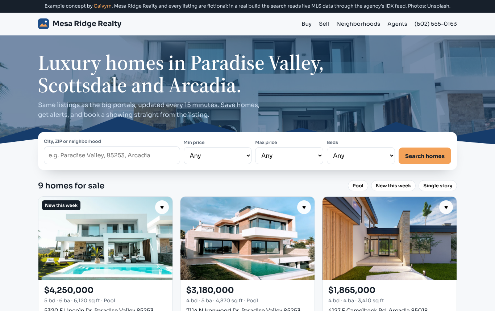
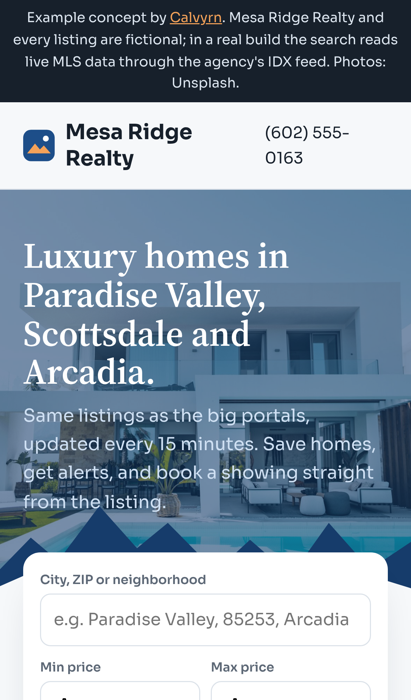

# Agency site with its own property search

**Tier:** Medium · **Industry:** Real estate

Search by place, price and beds, filter chips, saved homes and a showing request dialog. Built to plug into an IDX/MLS feed.

**Live demo:** https://calvyrn.github.io/portfolio/sites/real-estate-search/

| Desktop | Phone |
|---|---|
|  |  |

**Why it matters:** NAR's 2025 Profile found 52% of buyers found the home they bought online.

**Design:** Source Serif 4 + Sora; sky, saguaro, sun. Single HTML file, no framework, keyboard accessible, responsive down to 360 px.

The business, people, reviews and phone numbers (555 numbers) are fictional placeholders. Photos are free-licence images from Unsplash.

---
Want this for your business? **info@calvyrn.com** · [calvyrn.com/contact.html](https://calvyrn.com/contact.html)
