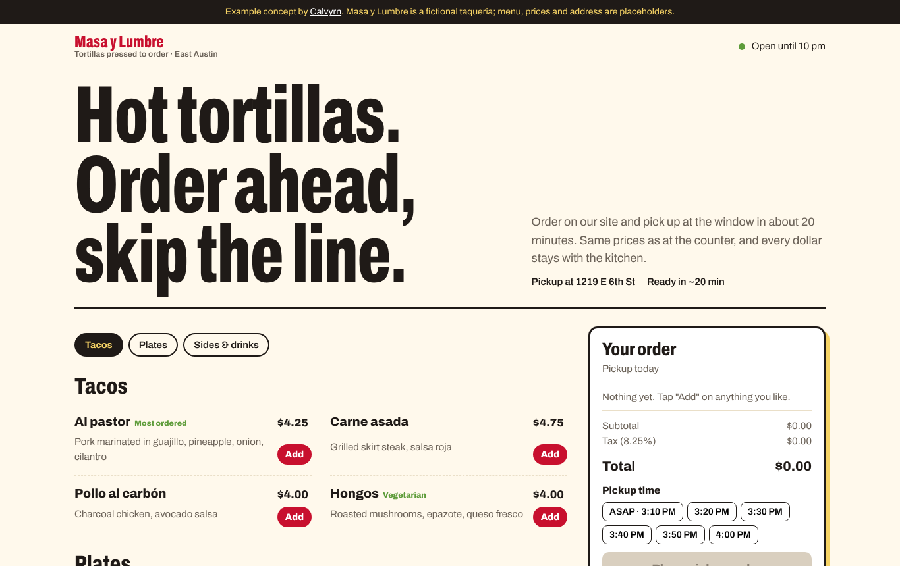
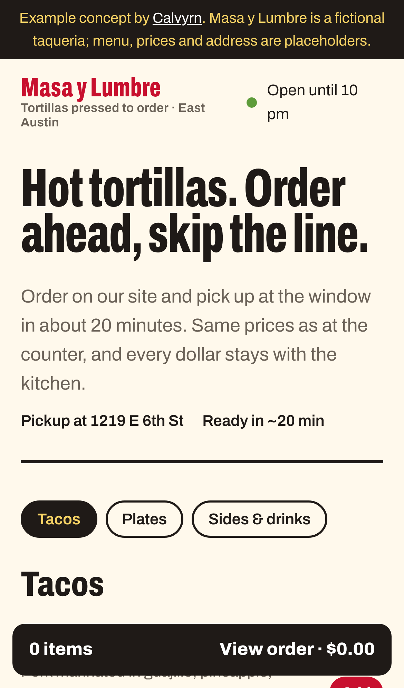

# Taqueria with commission-free pickup ordering

**Tier:** Medium · **Industry:** Restaurant

Sticky category tabs, add-to-order, quantity steppers, tax, live pickup time slots and a mobile order bar.

**Live demo:** https://calvyrn.github.io/portfolio/sites/restaurant-ordering/

| Desktop | Phone |
|---|---|
|  |  |

**Why it matters:** NCR Voyix's 2025 report found 58% of customers prefer ordering through a restaurant's own app or website.

**Design:** Archivo (condensed widths); chili, masa, charcoal. Single HTML file, no framework, keyboard accessible, responsive down to 360 px.

The business, people, reviews and phone numbers (555 numbers) are fictional placeholders.

---
Want this for your business? **info@calvyrn.com** · [calvyrn.com/contact.html](https://calvyrn.com/contact.html)
