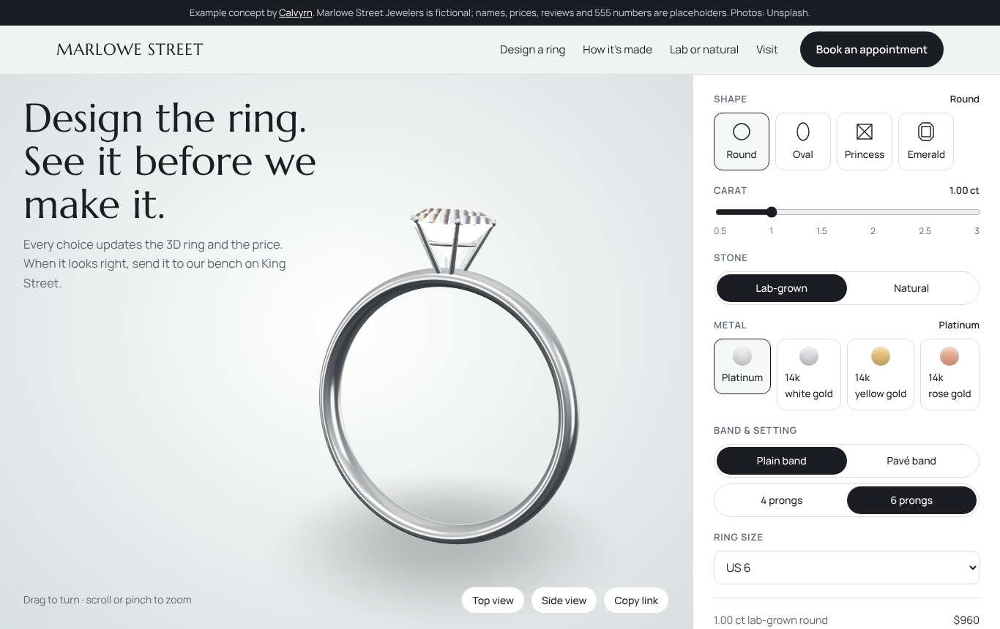
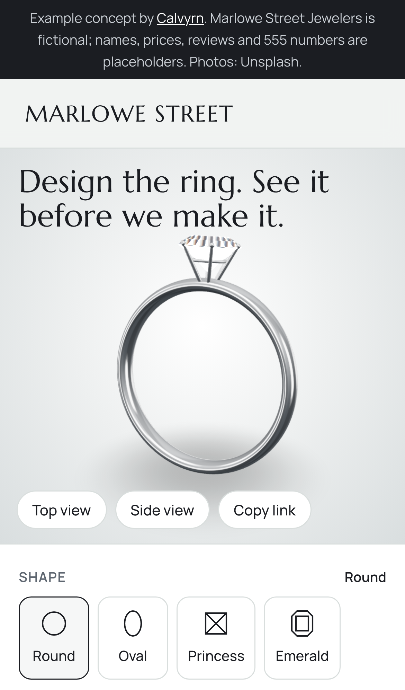

# Engagement ring designer in real-time 3D

**Tier:** High-end 3D · **Industry:** Jewelry / ecommerce

A jeweler's site where the hero is a working ring configurator. Pick the stone shape, carat, lab-grown or natural, metal, plain or pavé band, four or six prongs and ring size; the Three.js ring rebuilds instantly with real metal reflections and a refracting diamond, and the estimate updates line by line. Turn the ring, jump to top or side view, copy a link that reopens the exact design, and send it to the bench through a validated request form.

**Live demo:** https://calvyrn.github.io/portfolio/sites/ring-builder-3d/

| Desktop | Phone |
|---|---|
|  |  |

**Why it matters:** Ring buyers research for weeks and are nervous about price. Letting them build and price the ring themselves, then share it, brings them to the shop already decided.

**Design:** Marcellus + Manrope; porcelain, ink, champagne, slate. Procedural ring and gem geometry, custom studio lighting, physical transmission material for the diamond, shareable URL state, accessible dialog, reduced motion respected, responsive down to 360 px.

The business, people, prices, reviews and phone numbers (555 numbers) are fictional placeholders. Photos are free-licence images from Unsplash.

---
Want this for your business? **info@calvyrn.com** · [calvyrn.com/contact.html](https://calvyrn.com/contact.html)
