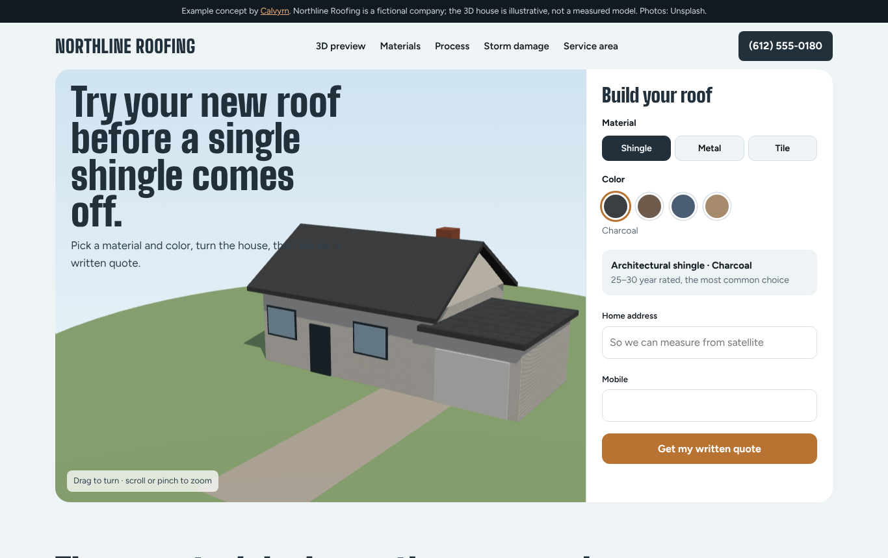
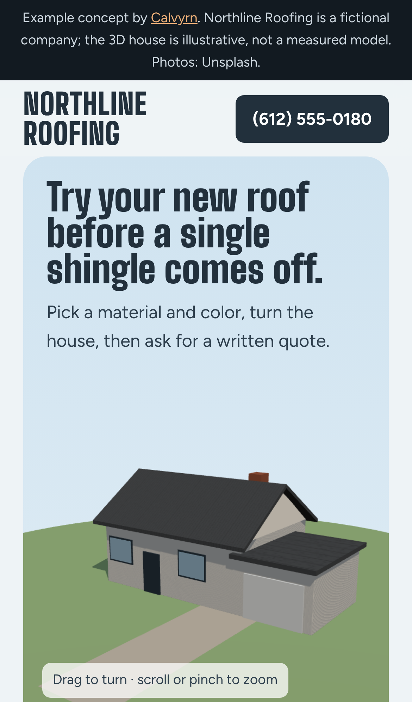

# Roofing company with a live 3D roof preview

**Tier:** High-end 3D · **Industry:** Home services

Three.js scene with soft shadows, orbit controls, procedural textures for shingle, metal and tile, color swatches and a quote form. Auto-rotate is off for reduced motion.

**Live demo:** https://calvyrn.github.io/portfolio/sites/roofing-3d/

| Desktop | Phone |
|---|---|
|  |  |

**Why it matters:** A visual preview makes it easier to choose before anyone climbs on the roof.

**Design:** Big Shoulders Display + Figtree; slate, copper, frost. Single HTML file, no framework, keyboard accessible, responsive down to 360 px.

The business, people, reviews and phone numbers (555 numbers) are fictional placeholders. Photos are free-licence images from Unsplash.

---
Want this for your business? **info@calvyrn.com** · [calvyrn.com/contact.html](https://calvyrn.com/contact.html)
