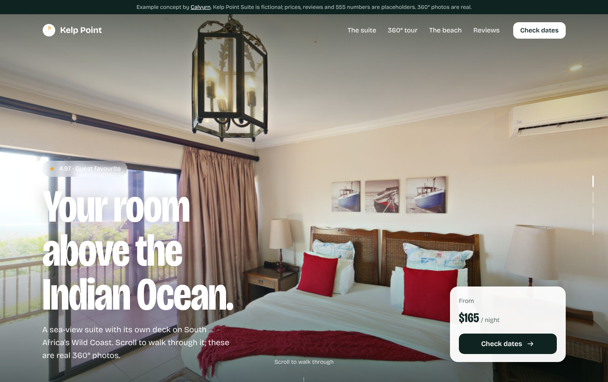
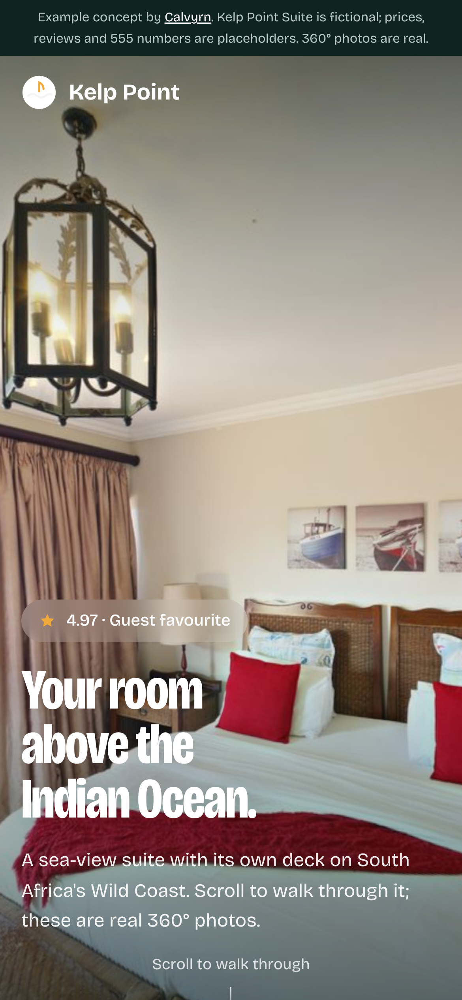

# Seaview rental suite you walk through in real 360°

**Tier:** High-end 3D · **Industry:** Hospitality

Scroll and you walk through the actual suite in real 360° photos: past the bed, through the sliding door and out onto the deck over the sea. Depth-3D photos, a full 360° tour with room hotspots, and a direct-booking card with live nightly totals.

**Live demo:** https://calvyrn.github.io/portfolio/sites/seaview-suite-360/

| Desktop | Phone |
|---|---|
|  |  |

**Why it matters:** Guests book what they can see. Walking the real room before paying removes the biggest doubt in a direct booking and cuts platform fees.

**Design:** Bricolage Grotesque; sea-glass, kelp and sun. Real equirectangular 360 photos in Three.js, scroll-driven camera with crossfades between rooms, depth-estimated 3D photos, Lenis, srcset 4K images, custom icons.

**How the 3D works:** the 360° views are real equirectangular photographs (Poly Haven, CC0) mapped inside a sphere; scrolling drives the camera and crossfades between rooms. The "3D photo" effect takes a real photo, estimates its depth with Depth Anything V2 (run offline), and displaces a dense mesh so the camera can move through it. Shared engine: [`shared/realview.js`](../../shared/realview.js).

The business, people, prices, reviews and phone numbers (555 numbers) are fictional placeholders. Photos: Unsplash.

---
Want this for your business? **info@calvyrn.com** · [calvyrn.com/contact.html](https://calvyrn.com/contact.html)
