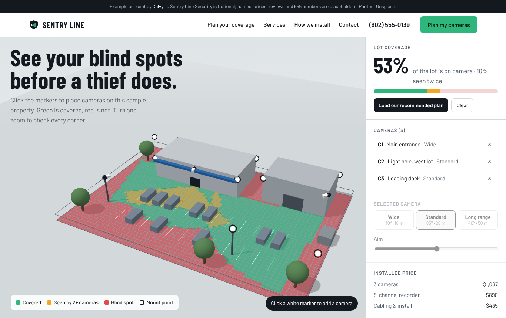
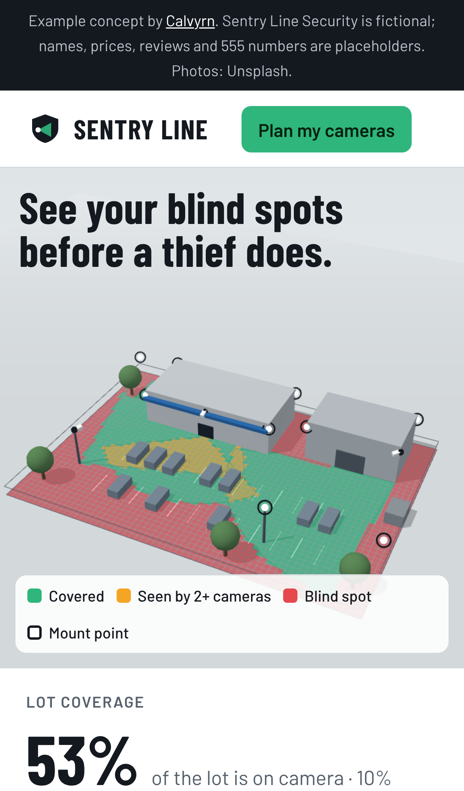

# Security camera installer with a 3D coverage planner

**Tier:** High-end 3D · **Industry:** Security / trades

The hero is a 3D model of a small commercial property. Click the mount points to place cameras, pick a lens and aim each one; every camera draws its real viewshed on the ground, blocked by buildings, trees and the dumpster, and each square metre of the lot turns green (covered), amber (seen twice) or red (blind spot). A live meter shows lot coverage, the installed price updates per camera, and the plan can be sent with a validated site-walk request. One click loads a recommended 12-camera plan that covers 98% of the lot.

**Live demo:** https://calvyrn.github.io/portfolio/sites/security-viewshed-3d/

| Desktop | Phone |
|---|---|
|  |  |

**Why it matters:** Owners can't picture what a camera will see. Showing the blind spots on their own lot, with a price, turns a vague "we need cameras" into a booked site visit.

**Design:** Barlow Condensed + Barlow; concrete grey, ink, coverage green, overlap amber, blind-spot red. Three.js scene with shadows, 2D line-of-sight coverage grid and occlusion-aware viewshed fans, accessible dialog, responsive down to 360 px. Inspired by the camera viewshed layer in open-source globes such as God's Eye View.

The business, people, prices, reviews and phone numbers (555 numbers) are fictional placeholders, and the property is a sample model. Photos are free-licence images from Unsplash.

---
Want this for your business? **info@calvyrn.com** · [calvyrn.com/contact.html](https://calvyrn.com/contact.html)
