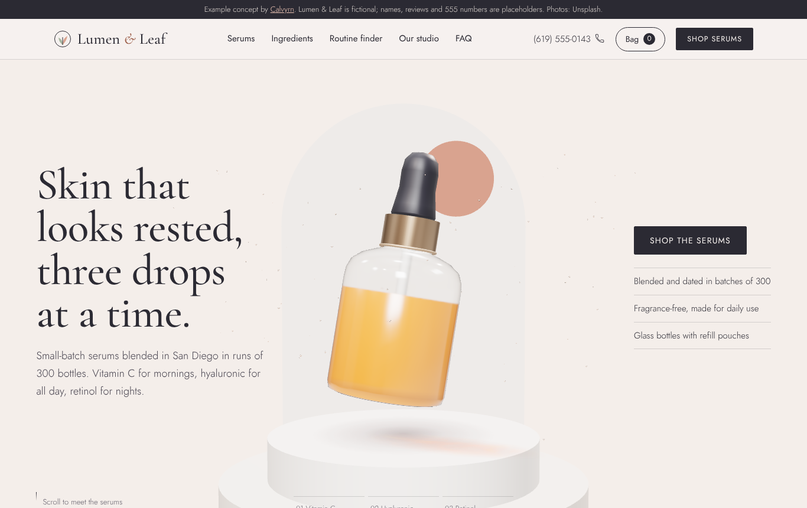
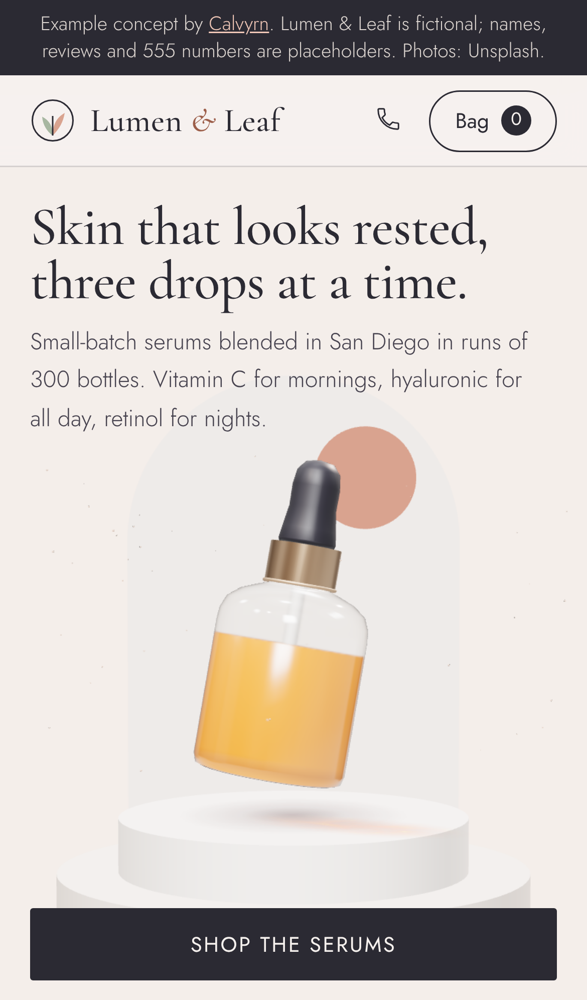

# Skincare brand with a 3D product launch and mini shop

**Tier:** High-end 3D · **Industry:** Beauty / e-commerce

Product-launch site for a small-batch serum brand: a glass dropper bottle built in Three.js floats on a pedestal, turns its label to camera on scroll, and changes liquid colour across three chapters (Vitamin C, Hyaluronic, Retinol) while ingredient pearls orbit and settle. Below it, a working mini shop with sizes, a bag drawer with subtotal and free-shipping progress, a demo checkout, and a three-question routine finder that adds the suggested routine to the bag.

**Live demo:** https://calvyrn.github.io/portfolio/sites/skincare-brand-3d/

| Desktop | Phone |
|---|---|
|  |  |

**Why it matters:** Shoppers can't touch or test a serum online, so a product that turns, shows its colour and texture, and goes straight into the bag does the job of a counter display.

**Design:** Cormorant Garamond + Jost; porcelain, ink, rose clay, sage. Three.js (LatheGeometry glass with transmission, RoomEnvironment lighting, caustic shader, instanced particles) and GSAP ScrollTrigger; product photos in the shop are rendered from the same 3D scene. Single HTML file, keyboard accessible, reduced-motion aware, responsive down to 360 px.

The business, people, reviews and phone numbers (555 numbers) are fictional placeholders. Photos are free-licence images from Unsplash.

---
Want this for your business? **info@calvyrn.com** · [calvyrn.com/contact.html](https://calvyrn.com/contact.html)
