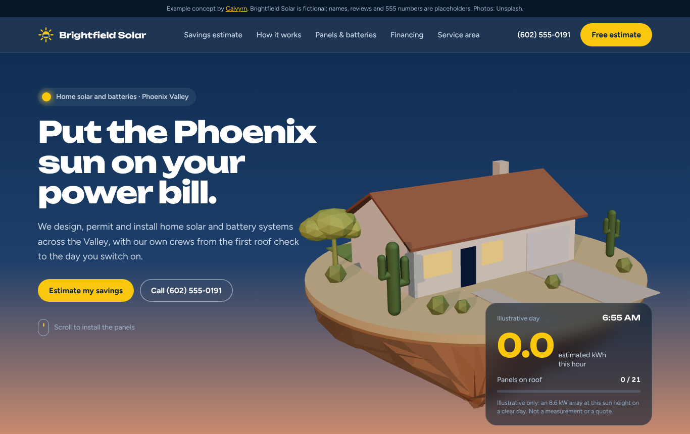
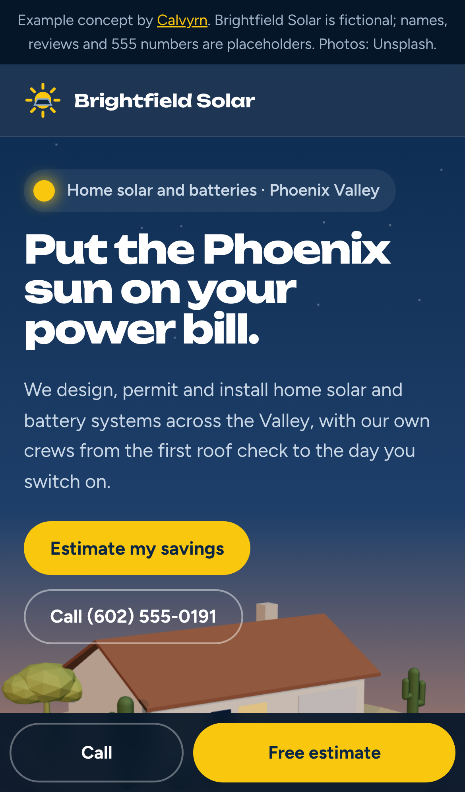

# Solar installer with a 3D install story and savings estimator

**Tier:** High-end 3D · **Industry:** Solar / home services

A procedural Three.js house sits on a floating desert island. As you scroll a pinned hero, solar panels fly in and tile onto the roof one row at a time. The sun crosses the sky, changing the light direction and colour, and a counter shows illustrative "estimated kWh this hour" based on the sun's height. Below that is a working savings estimator (monthly bill, roof direction, shade). It returns a system size, panel count, bill coverage and a yearly savings range, shows its formula assumptions, and is clearly labelled as an estimate, not a quote. A validated email form follows, then how it works, panel and battery options, a financing FAQ, placeholder reviews and the service area with a map.

**Live demo:** https://calvyrn.github.io/portfolio/sites/solar-installer-3d/

| Desktop | Phone |
|---|---|
|  |  |

**Why it matters:** Homeowners want a number before they talk to a salesperson. An honest estimate with its assumptions in plain view builds trust and brings in better leads.

**Design:** Unbounded + Figtree; night navy, sun yellow, white, deep blue and mist. Dark full-bleed hero into light sections, with big data numbers. Three.js (ACES tone mapping, soft shadows, procedural island, panels and sky), GSAP ScrollTrigger and Lenis. Single HTML file, no framework. Respects reduced motion and has a fallback if WebGL is missing.

The business, reviews, prices and phone number (555 number) are fictional placeholders. Photos are free-licence images from Unsplash.

---
Want this for your business? **info@calvyrn.com** · [calvyrn.com/contact.html](https://calvyrn.com/contact.html)
