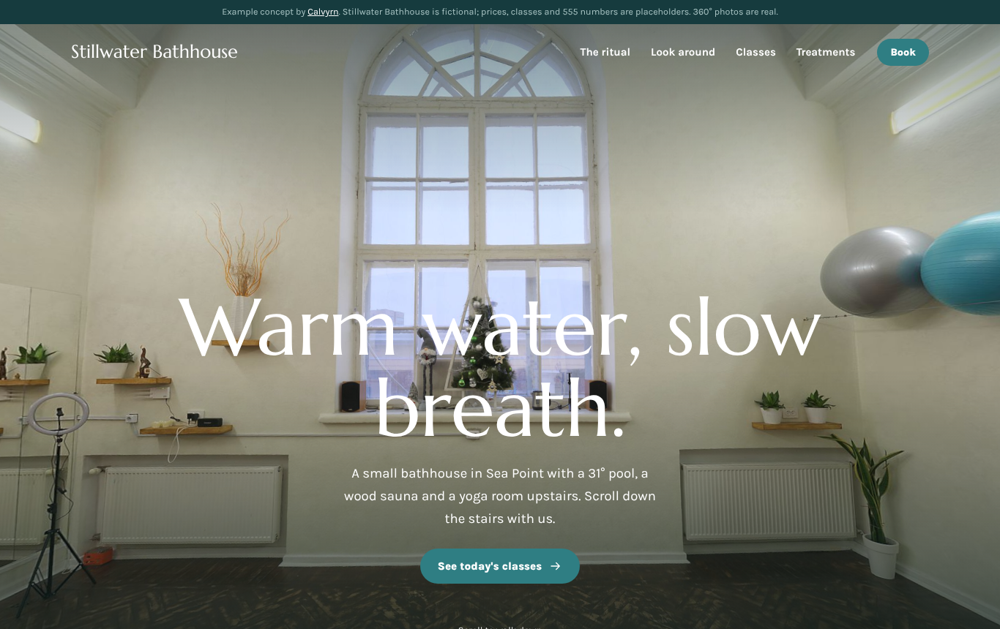
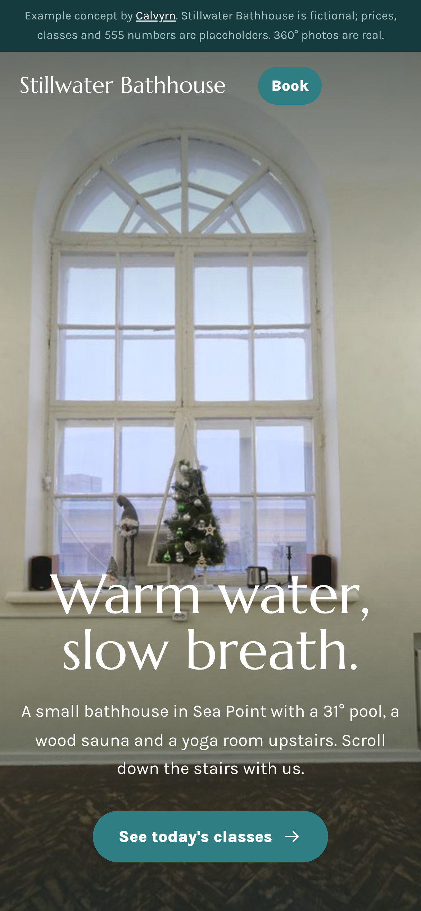

# Bathhouse and yoga studio with class booking

**Tier:** High-end 3D · **Industry:** Salon & spa

Walk down from a real yoga studio to a warm indoor pool in 360°, with the water temperature on screen. A five-step bathing ritual, a weekly class timetable with mats left, and treatments with lengths that add up into one visit.

**Live demo:** https://calvyrn.github.io/portfolio/sites/spa-pool-360/

| Desktop | Phone |
|---|---|
|  |  |

**Why it matters:** Wellness is bought on feeling. Showing the actual rooms and letting people save a mat or a massage in one place turns browsing into a booked visit.

**Design:** Marcellus with Karla; pool teal, birch and stone. Real 360 photos, scroll director, class timetable, treatment builder.

**How the 3D works:** the 360° views are real equirectangular photographs (Poly Haven, CC0) mapped inside a sphere; scrolling drives the camera and crossfades between rooms. The "3D photo" effect takes a real photo, estimates its depth with Depth Anything V2 (run offline), and displaces a dense mesh so the camera can move through it. Shared engine: [`shared/realview.js`](../../shared/realview.js).

The business, people, prices, reviews and phone numbers (555 numbers) are fictional placeholders. Photos: Unsplash.

---
Want this for your business? **info@calvyrn.com** · [calvyrn.com/contact.html](https://calvyrn.com/contact.html)
