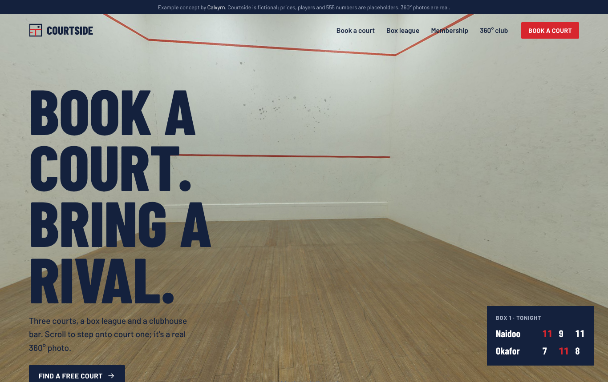
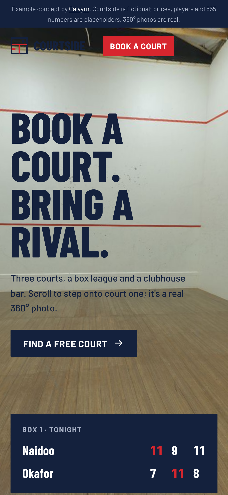

# Squash club with a live court grid and box league

**Tier:** High-end 3D · **Industry:** Fitness

Step onto a real squash court in 360° and look up at the gallery, then into the clubhouse. A court booking grid with peak pricing, a sortable box-league table, coaching and membership plans.

**Live demo:** https://calvyrn.github.io/portfolio/sites/squash-club-360/

| Desktop | Phone |
|---|---|
|  |  |

**Why it matters:** Club members want two things: a free court and the league table. Putting both on the homepage, with the court itself on show, brings new members in.

**Design:** Barlow Condensed with Barlow; court white, navy and line red. Real 360 photos, scroll director, booking grid, sortable league.

**How the 3D works:** the 360° views are real equirectangular photographs (Poly Haven, CC0) mapped inside a sphere; scrolling drives the camera and crossfades between rooms. The "3D photo" effect takes a real photo, estimates its depth with Depth Anything V2 (run offline), and displaces a dense mesh so the camera can move through it. Shared engine: [`shared/realview.js`](../../shared/realview.js).

The business, people, prices, reviews and phone numbers (555 numbers) are fictional placeholders. Photos: Unsplash.

---
Want this for your business? **info@calvyrn.com** · [calvyrn.com/contact.html](https://calvyrn.com/contact.html)
