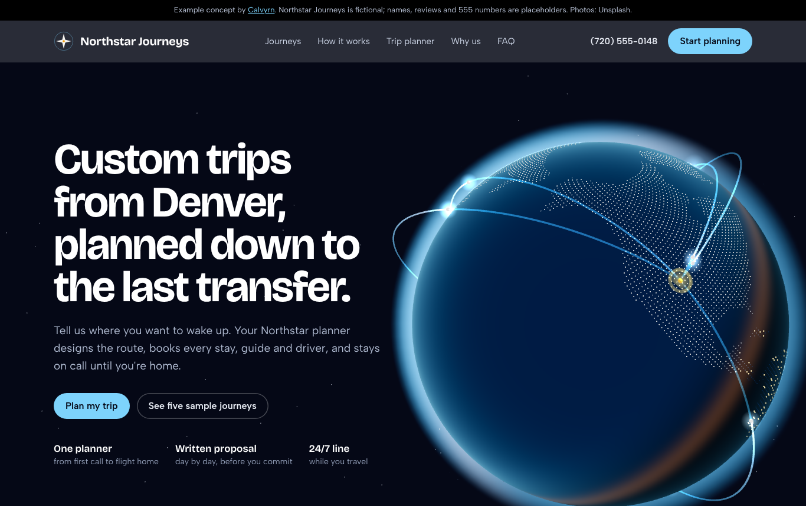
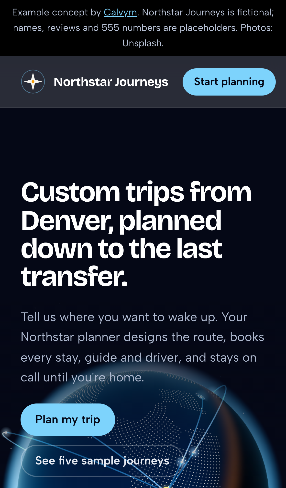

# Travel agency with a scroll-driven 3D globe

**Tier:** High-end 3D · **Industry:** Travel

A boutique Denver travel agency site whose hero is a live WebGL globe: dotted continents, a night side with city lights, an atmosphere glow and flight arcs from Denver to five destinations. As you scroll, the globe turns to each destination while a card with ideal months, a sample 7-day itinerary and a starting price slides in. Below it, a working trip planner (destination, month, travellers, budget per person, interests) returns a summary and a "planner replies within one business day" confirmation.

**Live demo:** https://calvyrn.github.io/portfolio/sites/travel-agency-3d/

| Desktop | Phone |
|---|---|
|  |  |

**Why it matters:** A custom trip is a big, slow decision. Showing real routes, seasons and sample days up front lets a visitor picture the trip before the first call, and the brief form gives the planner everything needed for a useful first reply.

**Design:** Bricolage Grotesque + Albert Sans; space navy, paper, glow blue, sunrise amber. Three.js globe built procedurally (fibonacci-point land mask from coarse continent outlines, fresnel atmosphere shader, great-circle tube arcs), GSAP ScrollTrigger pinning, ACES tone mapping. Pauses off-screen, static layout for reduced motion, WebGL fallback text. Single HTML file, responsive down to 360 px.

The business, reviews, prices and phone numbers (555 numbers) are fictional placeholders. Destination photos are representative mood images. Photos are free-licence images from Unsplash.

---
Want this for your business? **info@calvyrn.com** · [calvyrn.com/contact.html](https://calvyrn.com/contact.html)
