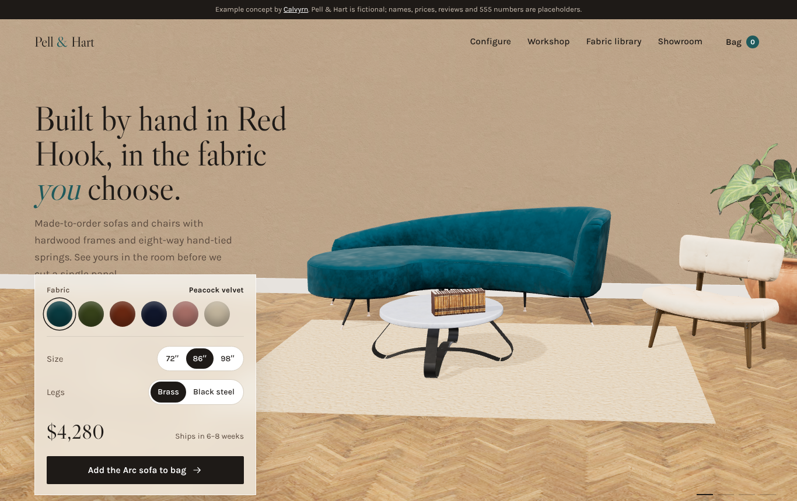
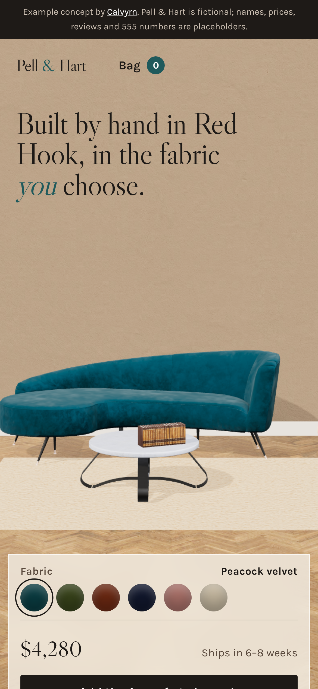

# Made-to-order sofa studio with a photoreal 3D room

**Tier:** High-end 3D · **Industry:** Furniture / upholstery

The hero is a photoreal 3D living room: a curved velvet sofa, an armchair, a coffee table and a plant on a herringbone floor, lit by a real studio HDRI with soft shadows. Pick a velvet and the sofa re-dyes itself (with true velvet sheen) while the site's accent colour follows it; size and leg finish update the price live and add a configured sofa to the bag. Scrolling drives a camera move through three chapters (the fabric close-up, the frame and armchair, an overhead of the room). Below: a full-bleed 4K room photo with parallax, the workshop story with a custom icon set, a fabric library where visitors pick up to five free swatches and request them by post, reviews, FAQ, and the showroom with a map.

**Live demo:** https://calvyrn.github.io/portfolio/sites/upholstery-3d/

| Desktop | Phone |
|---|---|
|  |  |

**Why it matters:** A made-to-order sofa is a $4,000 decision made from a fabric swatch. Seeing the exact piece, in the exact colour, in a real-looking room, then getting swatches in the post, is what turns a browser into a deposit.

**Design:** Libre Caslon Display with Karla; plaster, paper, walnut-brown ink and a live fabric-colour accent. Three.js with GLTF + Meshopt, KHR sheen velvet, RGBE studio lighting, PBR floor and wall textures, PCF soft shadows, Lenis smooth scroll, preloader with real progress, responsive 4K images via srcset, reduced motion respected.

The business, people, prices, reviews and phone numbers (555 numbers) are fictional placeholders. 3D sofa: "GlamVelvetSofa" by Wayfair, CC BY 4.0; 3D chair: "SheenChair" by Wayfair, CC0 (both Khronos glTF sample assets; chair label removed). Coffee table, plant, books, textures and HDRI: Poly Haven, CC0. Photos: Unsplash.

---
Want this for your business? **info@calvyrn.com** · [calvyrn.com/contact.html](https://calvyrn.com/contact.html)
