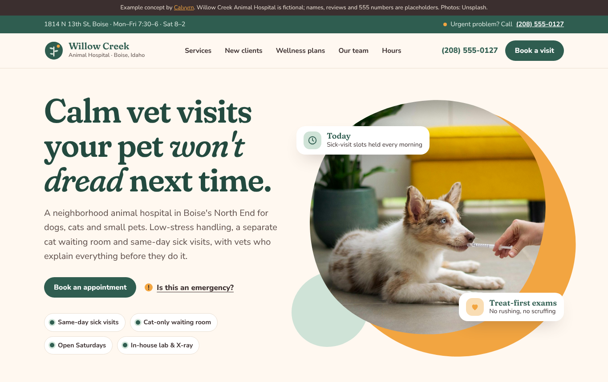
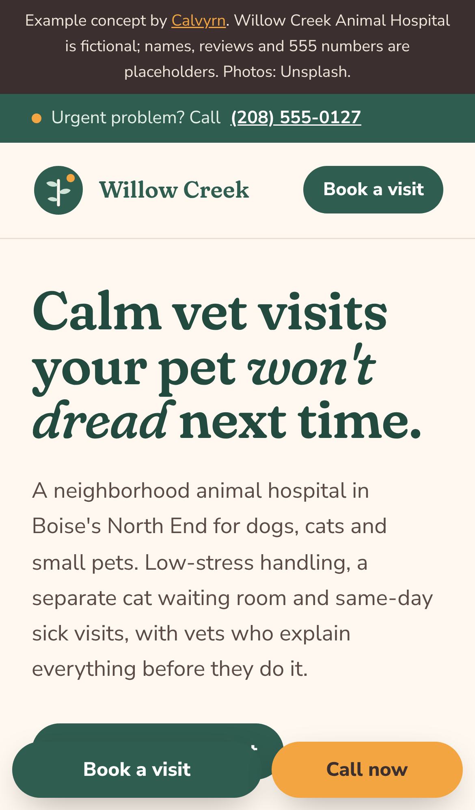

# Veterinary clinic with pet booking

**Tier:** Medium · **Industry:** Veterinary

A warm, friendly animal hospital site with a four-step booking flow (pet type and name, reason, day and time, owner details, confirmation) and an "Is this an emergency?" checker that tells owners to call right away or go to an emergency vet when urgent signs are ticked. It also covers services, new-client info, wellness plans, the team, hours and a map.

**Live demo:** https://calvyrn.github.io/portfolio/sites/vet-clinic/

| Desktop | Phone |
|---|---|
|  |  |

**Why it matters:** Pet owners book when they're worried, often in the evening. Online booking catches them then, and a plain emergency checklist keeps urgent cases on the phone instead of waiting for an online slot.

**Design:** Fraunces (soft) + Nunito Sans; willow green, warm white, golden, bark, mint. Organic blob masks on photos, rounded shapes and wave dividers. Single HTML file, no framework, keyboard accessible, respects reduced motion, responsive down to 360 px.

The business, people, reviews and phone numbers (555 numbers) are fictional placeholders. Photos are free-licence images from Unsplash.

---
Want this for your business? **info@calvyrn.com** · [calvyrn.com/contact.html](https://calvyrn.com/contact.html)
