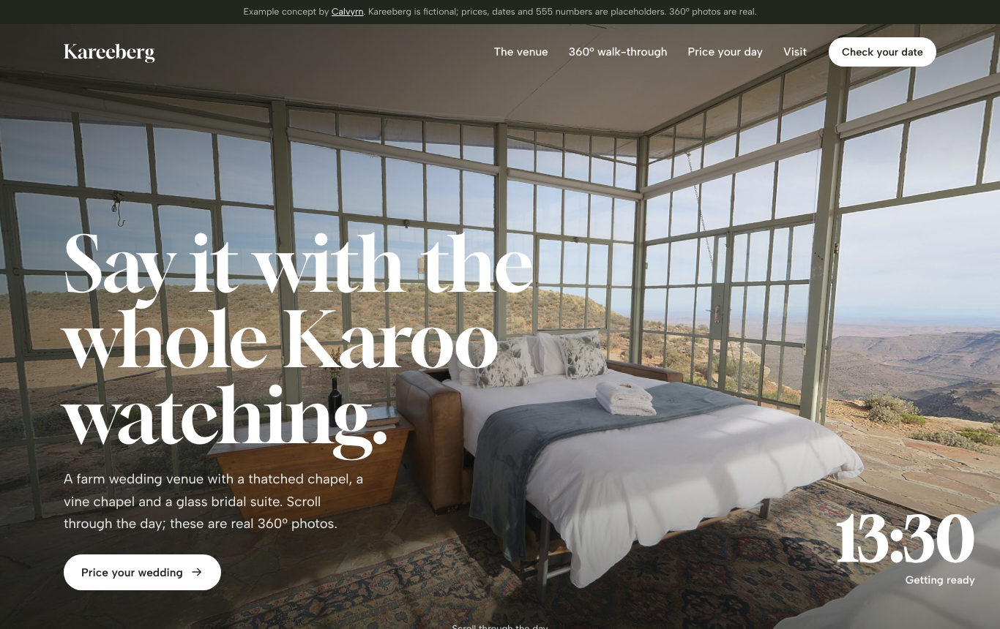
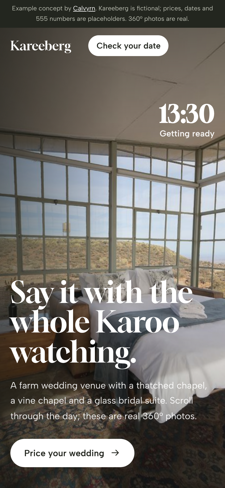

# Farm wedding venue: walk the whole day in 360°

**Tier:** High-end 3D · **Industry:** Weddings

Scroll through a wedding day in real 360° photos: the glass bridal suite above the Karoo, down the aisle of a thatched chapel to its round window, then out to a vine chapel. A price builder with season, guests and extras, an availability calendar with booked Saturdays, and viewing requests.

**Live demo:** https://calvyrn.github.io/portfolio/sites/wedding-farm-360/

| Desktop | Phone |
|---|---|
|  |  |

**Why it matters:** Couples shortlist venues from far away. Standing where they'll say their vows, with an honest price for their date, gets them to book the viewing.

**Design:** Gloock with Albert Sans; sage, ink and olive, arched frames. Real 360 photos, scroll director with a wedding-day clock, depth-3D photos, calendar and price builder.

**How the 3D works:** the 360° views are real equirectangular photographs (Poly Haven, CC0) mapped inside a sphere; scrolling drives the camera and crossfades between rooms. The "3D photo" effect takes a real photo, estimates its depth with Depth Anything V2 (run offline), and displaces a dense mesh so the camera can move through it. Shared engine: [`shared/realview.js`](../../shared/realview.js).

The business, people, prices, reviews and phone numbers (555 numbers) are fictional placeholders. Photos: Unsplash.

---
Want this for your business? **info@calvyrn.com** · [calvyrn.com/contact.html](https://calvyrn.com/contact.html)
