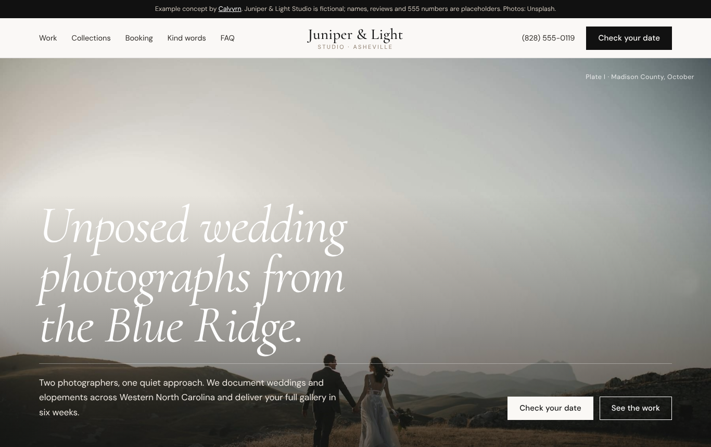
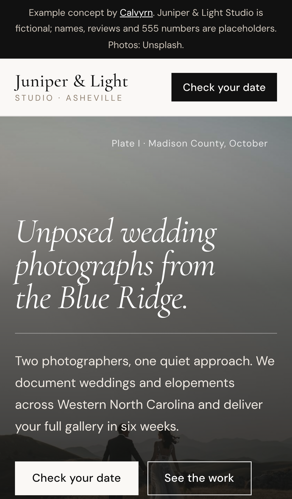

# Wedding photographer with gallery and inquiry form

**Tier:** Simple · **Industry:** Photography

An editorial, photography-first site for an Asheville wedding studio: full-screen hero, a masonry gallery with an accessible lightbox (Esc to close, arrow keys to browse, focus returned on close), three collections with starting prices, how booking works, placeholder kind words, and an inquiry form with date picker, venue, guest count and "how did you hear" that confirms the request.

**Live demo:** https://calvyrn.github.io/portfolio/sites/wedding-photographer/

| Desktop | Phone |
|---|---|
|  |  |

**Why it matters:** Couples shortlist photographers by their work and their price range. Showing both up front, then asking for the date first, means the inquiries that arrive are from couples who already fit, and the studio can answer availability in one reply.

**Design:** Cormorant (italic only in the hero) + DM Sans; ink, warm paper, taupe, sand and umber. Magazine-style running heads, hairline borders and large photography. Single HTML file, no framework, keyboard accessible, responsive down to 360 px.

The business, people, reviews and phone numbers (555 numbers) are fictional placeholders. Photos are free-licence images from Unsplash.

---
Want this for your business? **info@calvyrn.com** · [calvyrn.com/contact.html](https://calvyrn.com/contact.html)
