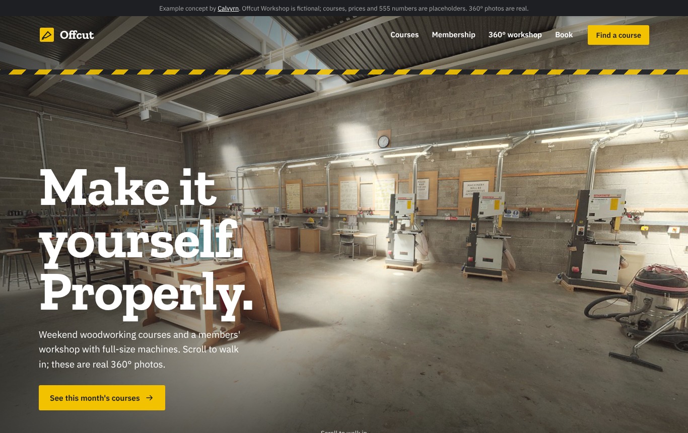
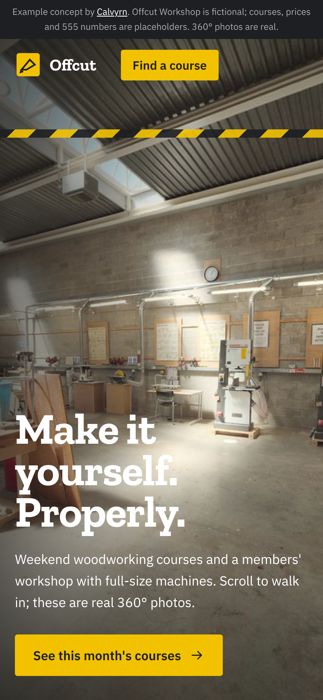

# Woodworking school and maker space in real 360°

**Tier:** High-end 3D · **Industry:** Education

Scroll from the machine shop into an old mill loft in real 360° photos. Course cards with dates and seats left, a woodturning depth-3D band, membership tiers and a booking form that checks availability.

**Live demo:** https://calvyrn.github.io/portfolio/sites/woodworking-school-360/

| Desktop | Phone |
|---|---|
|  |  |

**Why it matters:** People nervous about machines want to see the shop first. A real walk-through and clear dates fill weekend courses that turn into memberships.

**Design:** Zilla Slab with IBM Plex Sans; birch, machine green and safety-tape yellow. Real 360 photos, depth-3D photos, filterable courses.

**How the 3D works:** the 360° views are real equirectangular photographs (Poly Haven, CC0) mapped inside a sphere; scrolling drives the camera and crossfades between rooms. The "3D photo" effect takes a real photo, estimates its depth with Depth Anything V2 (run offline), and displaces a dense mesh so the camera can move through it. Shared engine: [`shared/realview.js`](../../shared/realview.js).

The business, people, prices, reviews and phone numbers (555 numbers) are fictional placeholders. Photos: Unsplash.

---
Want this for your business? **info@calvyrn.com** · [calvyrn.com/contact.html](https://calvyrn.com/contact.html)
