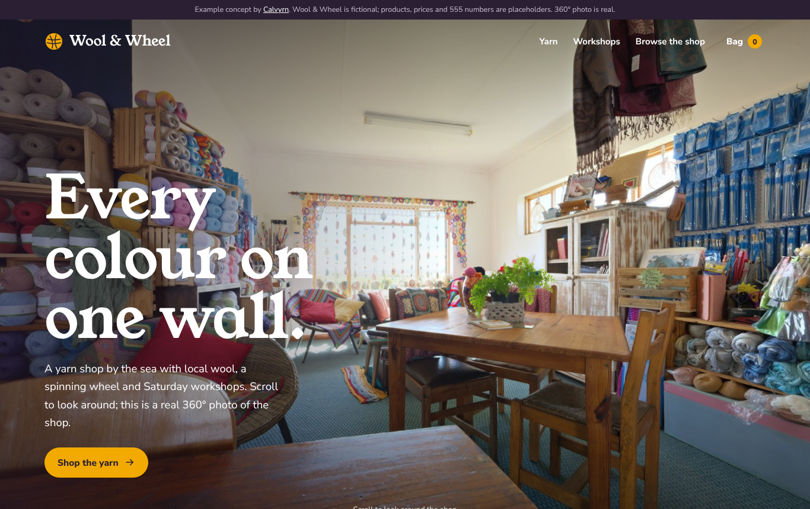
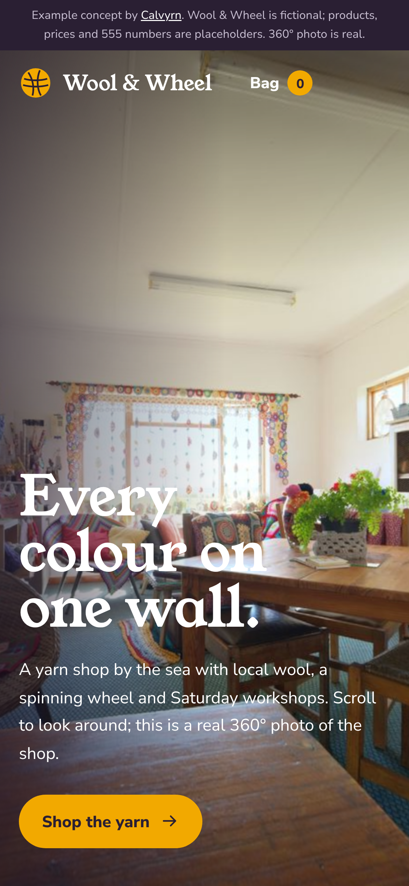

# Yarn shop where the 360° shelves are shoppable

**Tier:** High-end 3D · **Industry:** Retail

Look around a real yarn shop in 360°; as you scroll, products pop up for the shelf you're facing. In the tour, tap a shelf to add it to your bag. Colourway pickers, a free-delivery meter, a bag drawer and Saturday workshops.

**Live demo:** https://calvyrn.github.io/portfolio/sites/yarn-shop-360/

| Desktop | Phone |
|---|---|
|  |  |

**Why it matters:** Small shops sell on atmosphere and range. Letting online visitors browse the actual shelves and buy from them brings the shop's feel to the website.

**Design:** Young Serif with Nunito Sans; lavender, aubergine, marigold and moss. Real 360 photo with product hotspots, depth-3D photos, cart drawer.

**How the 3D works:** the 360° views are real equirectangular photographs (Poly Haven, CC0) mapped inside a sphere; scrolling drives the camera and crossfades between rooms. The "3D photo" effect takes a real photo, estimates its depth with Depth Anything V2 (run offline), and displaces a dense mesh so the camera can move through it. Shared engine: [`shared/realview.js`](../../shared/realview.js).

The business, people, prices, reviews and phone numbers (555 numbers) are fictional placeholders. Photos: Unsplash.

---
Want this for your business? **info@calvyrn.com** · [calvyrn.com/contact.html](https://calvyrn.com/contact.html)
